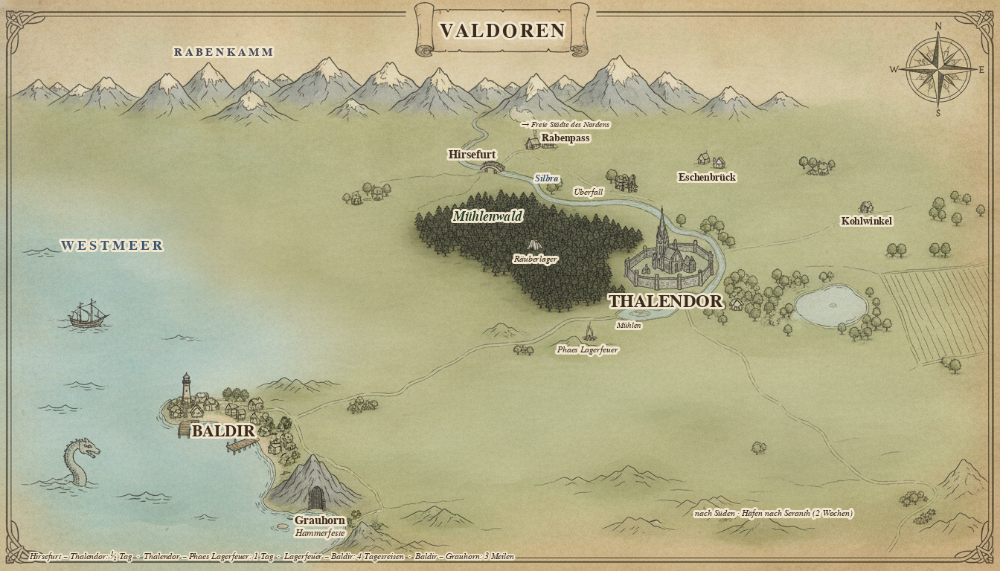

# Landkarte: Valdoren

Datei: `Landkarte/Landkarte-Valdoren.png` (zum Herzeigen am Tisch, Stand 20.11.2026).
Ohne Beschriftung: `Landkarte-ohne-Beschriftung.png`; neu beschriften (z. B. mit anderem Ländernamen):
`python3 Tools/landkarte_beschriften.py VALDOREN`.

## Das Land

**Valdoren** ist der Name des Landes, in dem die Kampagne spielt (Arbeitsname seit 20.11.2026).
Es liegt südlich des Rabenkamms und der Freien Städte des Nordens, am Westmeer.
Die Häfen mit Schiffen nach Seranth liegen gut zwei Wochen weiter südlich, unterhalb des Kartenrands.

## Was wo liegt

| Ort | Lage | Kapitel |
|---|---|---|
| **Rabenpass** | Pass im Rabenkamm, ganz im Norden; dahinter die Freien Städte des Nordens | Vorgeschichte |
| **Hirsefurt** | Dorf an der Silbra, einen halben Tag nördlich von Thalendor | 0 |
| **Eschenbrück, Kohlwinkel** | Tamos nächste zwei Dörfer, östlich von Hirsefurt in den Hügeln | 0 |
| **Überfall** | Straße Hirsefurt–Thalendor, eine Stunde vor der Stadt am Rand des Mühlenwalds | 0.5 |
| **Thalendor** | Stadt des Fests an der Silbra, Nordtor Richtung Hirsefurt | 0.5 bis 4 |
| **Mühlen und Mühlenwald** | westlich der Stadt; das Räuberlager zwei bis drei Stunden tief im Wald | 1, 4 |
| **Phaes Lagerfeuer** | Hügel eine Tagesreise südwestlich von Thalendor | 4b |
| **Baldir** | Hafenstadt am Kliff über der Sichelbucht, vier Tagesreisen weiter westlich | 5 |
| **Grauhorn** | Bergrücken drei Meilen südlich von Baldir an der Küste, darin die Hammerfeste, darunter die Bucht | 6 |
| **Straße nach Süden** | von Thalendor zu den Seranth-Häfen (zwei Wochen) | Epilog |

## Neue Namen auf der Karte

- **Valdoren** – das Land
- **Westmeer** – das Meer vor Baldir
- **Silbra** – der Fluss aus dem Rabenkamm durch Hirsefurt und Thalendor; endet im See östlich der Stadt
- **Rabenkamm** – das Gebirge im Norden mit dem Rabenpass

## Entfernungen

- Hirsefurt – Thalendor: ein halber Tag zu Fuß
- Thalendor – Phaes Lagerfeuer: eine Tagesreise
- Lagerfeuer – Baldir: vier Tagesreisen
- Baldir – Grauhorn: drei Meilen (Küstenstraße oder Boot)
- Thalendor – Seranth-Häfen: gut zwei Wochen nach Süden

Die Karte ist eine grobe Übersicht, kein Maßstab.
