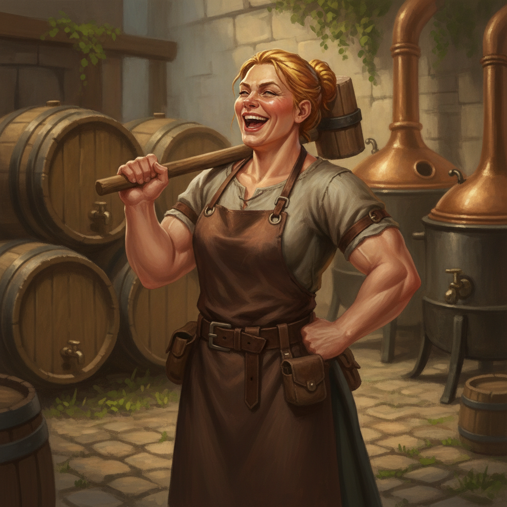

# Brauerin Thea Glutfaust

**Brauerei im Westen von Sommerhall.** Mitte vierzig, Arme wie Fässer, Stimme wie ein Zapfhahn, lacht laut und flucht lauter. Ihr gehört die Brauerei; ihr Jahrgangs-Dunkelbier („das gute Zeug“) gibt es nur abends in der Festhalle, und die Helden retten es auf dem Weg nach Sommerhall vor Räubern. Haut im Kampf selbst mit (Schlegel +4, 1W8+2). Steht am Festabend am Ausschank, schlägt beim „Anstich“ das erste Fass an und zeigt dem besten Werfer die Kellertreppe hinter dem Ausschank. Mutter von Mira; bei der Evakuierung ein Verbündeter mit Stimme.

→ `Story/Erzaehler/00b-Der-Weg-nach-Sommerhall.md`, `Story/Erzaehler/01b-Festspiele.md`
