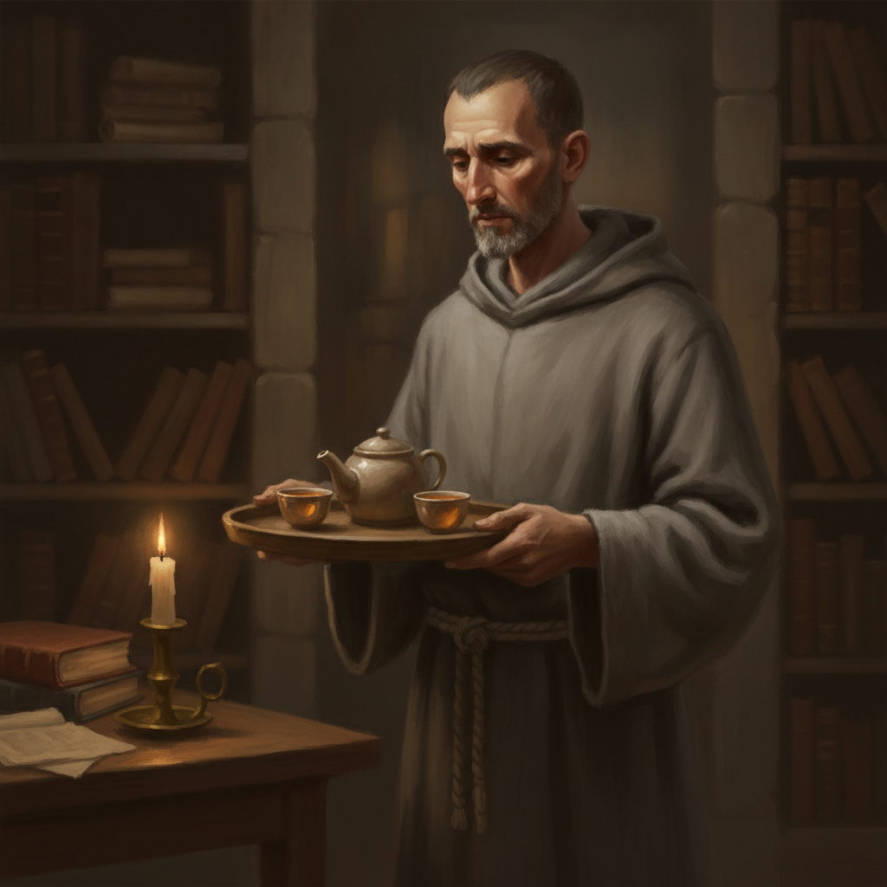

# Bruder Edrik

**Der Dieb der Vier Reliquien.** Stiller, zuverlässiger Archivgehilfe, der über ein Jahr lang im Gezeitenturm arbeitete und Neridas Vertrauen hatte. In der Nacht der tiefsten Ebbe mischte er den Turmwächtern Schlafmohn in den Tee, öffnete das Gewölbe der Vier und reichte die Reliquien durch den Flutkanal an vier Kultisten im Boot. Sein Tagebuch nennt „den Meister in den Kornfeldern“ (Malrik). Die Helden treffen ihn nicht mehr lebend: Die Diebe schlossen sich in der Tresorkammer der Hammerfeste vor Gorrum ein und verdursteten.

→ `Story/Erzaehler/05-Baldir.md`, `Stadt/Baldir/Orte/Gezeitenarchiv.md`
