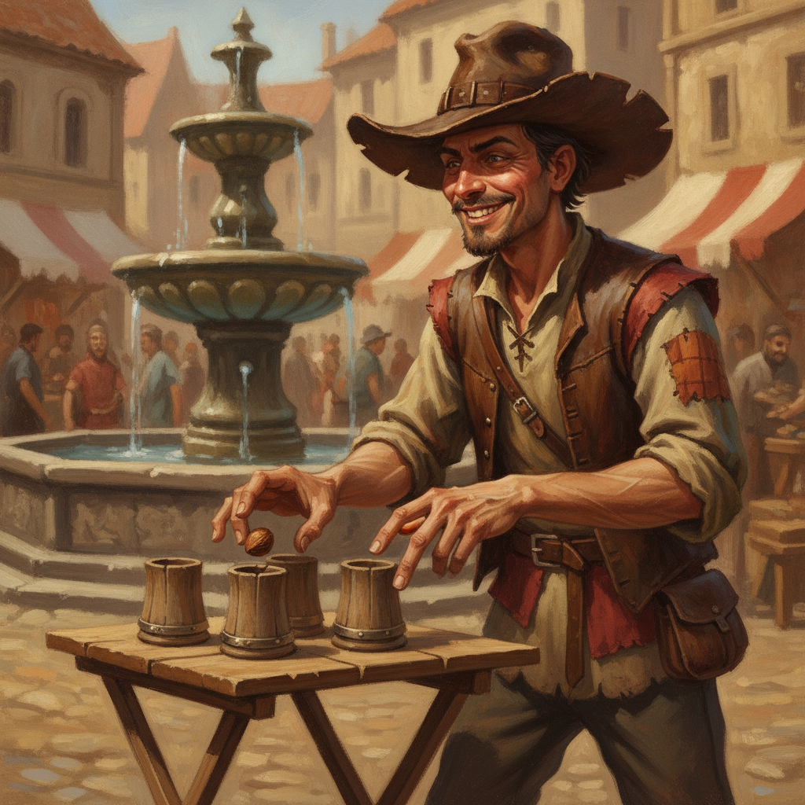

# Der Flinke Pit

**Hütchenspieler am Brunnen.** Kein Sommerhaller, nur zum Fest in der Stadt: ein Klapptisch am Brunnenrand, drei Becher, eine Nuss, ein Silber Einsatz. Schiebt die Nuss in den Ärmel und klaut bei schlechten Würfen gleich noch den Geldbeutel. Wer ihn erwischt, bekommt von Baldric lachend seinen Hut mit 15 Gold Kleingeld, den Einsätzen des Tages.

→ `Story/Erzaehler/01b-Festspiele.md`
