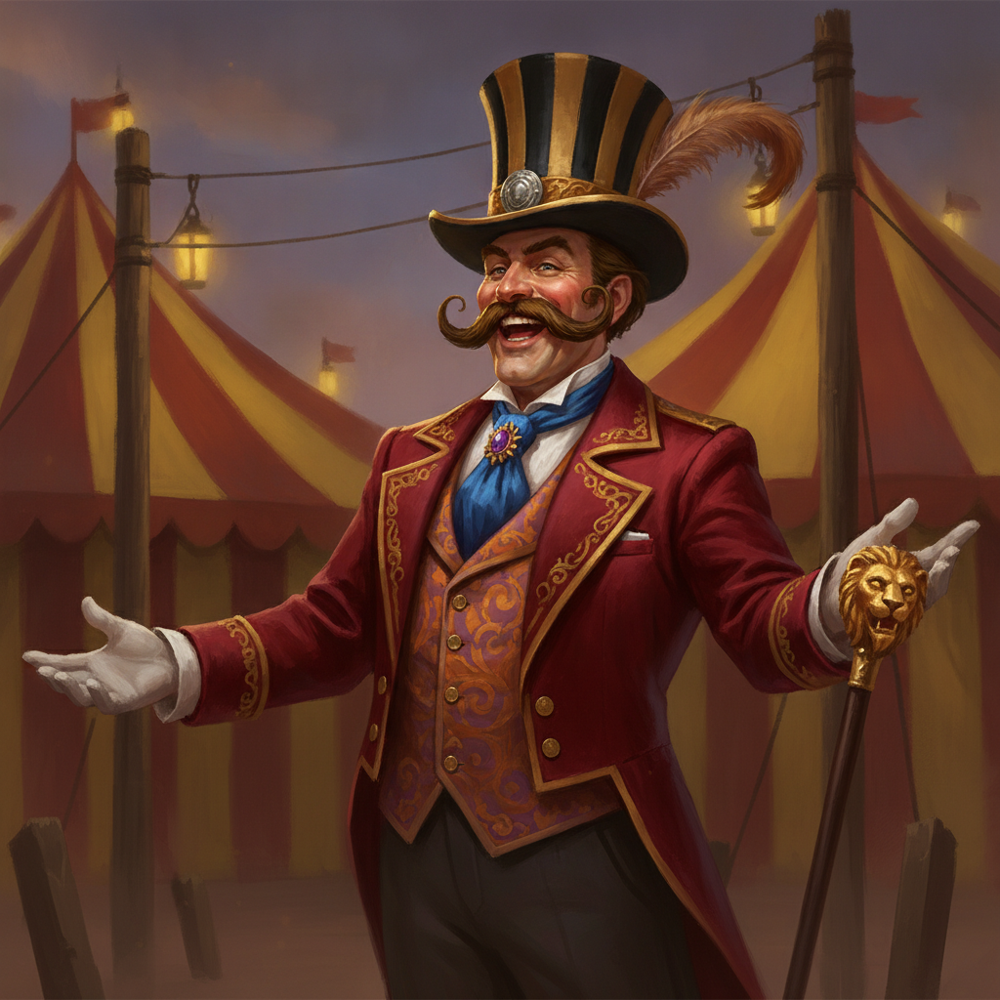

# Direktor Ottokar Flimm

**Wanderzirkus Flimm.** Zylinder, Schnauzbart, redet ohne Punkt und Komma. Sein gelbes Zirkuszelt steht beim Fest auf dem Festplatz, davor das Seil für „Zillis Seil“. Trommelt Gäste zusammen und feiert jeden Mutigen („Ein Applaus für den Mut!“). Nimmt Valerian Quecks seit zwölf Jahren mit, „weil er pünktlich zahlt“. Der Zirkus reist am Morgen nach dem Fest ab; im zweiten Durchlauf können seine Wagen bei der Evakuierung Dutzende Menschen mitnehmen.

→ `Story/Erzaehler/01b-Festspiele.md`
