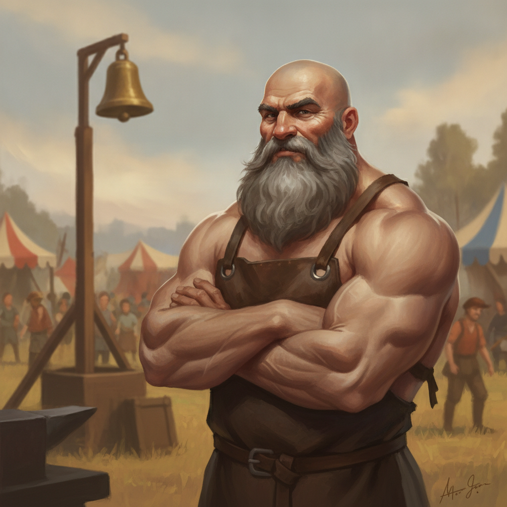

# „Eisenhand“ Grom

**Schmied von Sommerhall.** Der Schmied der Stadt, ungeschlagen im Armdrücken (würfelt mit +6), Hände wie Schraubstöcke. Steht beim „Hau den Lukas“ mit verschränkten Armen und kommentiert knapp („Beinahe. Beinahe ist gut.“), brummt auf der Bühne eine Strophe Schmiedelied. Wer ihn am Abend im Armdrücken schlägt, hat einen Freund fürs Leben. Beim Ritual schwingt er seinen Hammer gegen den Dämon, wenn ihn niemand abhält; fehlt Baldric, ist er der heldenhafte Angreifer, der an seinem eigenen Schlag stirbt.

→ `Story/Erzaehler/01b-Festspiele.md`, `Story/Erzaehler/02-Ritual-und-Daemon.md`
