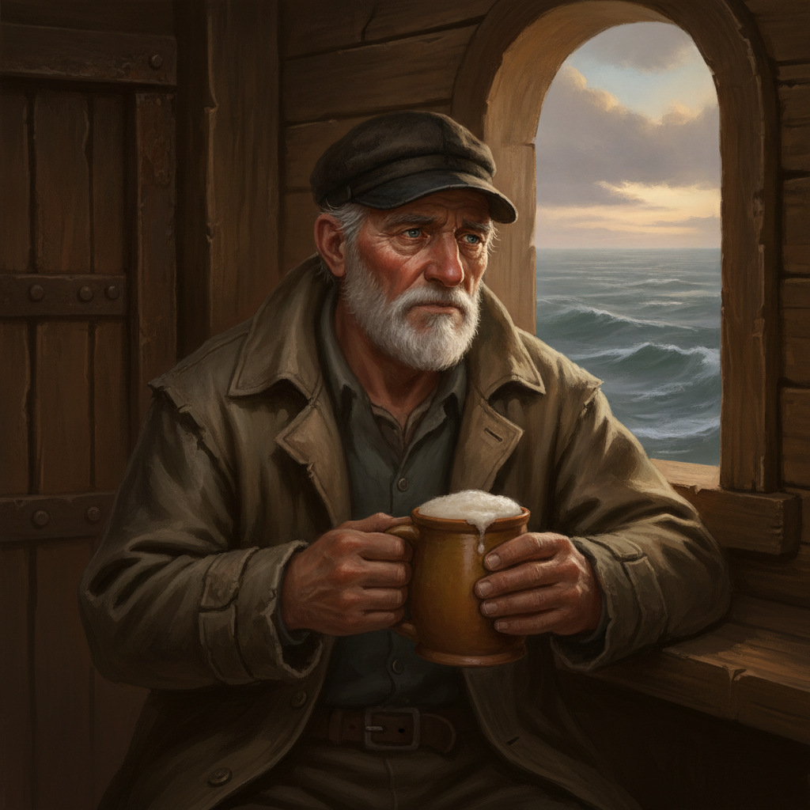

# Fischer Grim

**Stammgast in der „Salzigen Möwe“, Baldir.** Alter Fischer mit Stammplatz am Fenster der Taverne. Erzählt für einen Krug vom Grauhorn: Sein Bruder sah die Diebe anlanden, lief ihnen bis zum Bergtor nach und kam ohne Stimme zurück. Sein Neffe Jannik war bei der verschollenen Kompanie der Salzklingen. Zeigt die Bucht unter dem Berg, bietet sein Boot an („Bringt wenigstens Jannik heim“) und rückt nach dem zweiten Krug Janniks Hakenseil heraus.

→ `Story/Erzaehler/05-Baldir.md`, `Stadt/Baldir/Orte/Taverne-Zur-Salzigen-Moewe.md`
