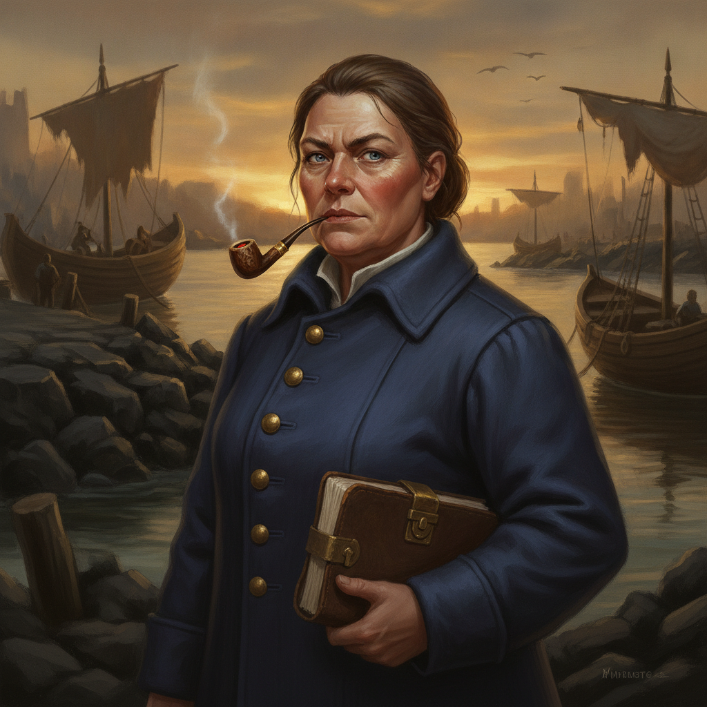

# Hafenmeisterin Brenka

**Amtsstube am Kai von Baldir.** Pragmatisch, bestechlich mit gutem Tabak, weiß alles über ein- und auslaufende Schiffe und wer mit wem Ärger hat. Zahlt 50 Gold für Hinweise auf die Schmuggler von Aal-Lene; wer die Bande auffliegen lässt, bekommt ihren Dank, freie Bootsnutzung und die Feuerfässchen der Turmwache ohne Wurf.

→ `Stadt/Baldir/Orte/Hafen.md`, `Quests/Nebenquest-Schmuggler.md`
