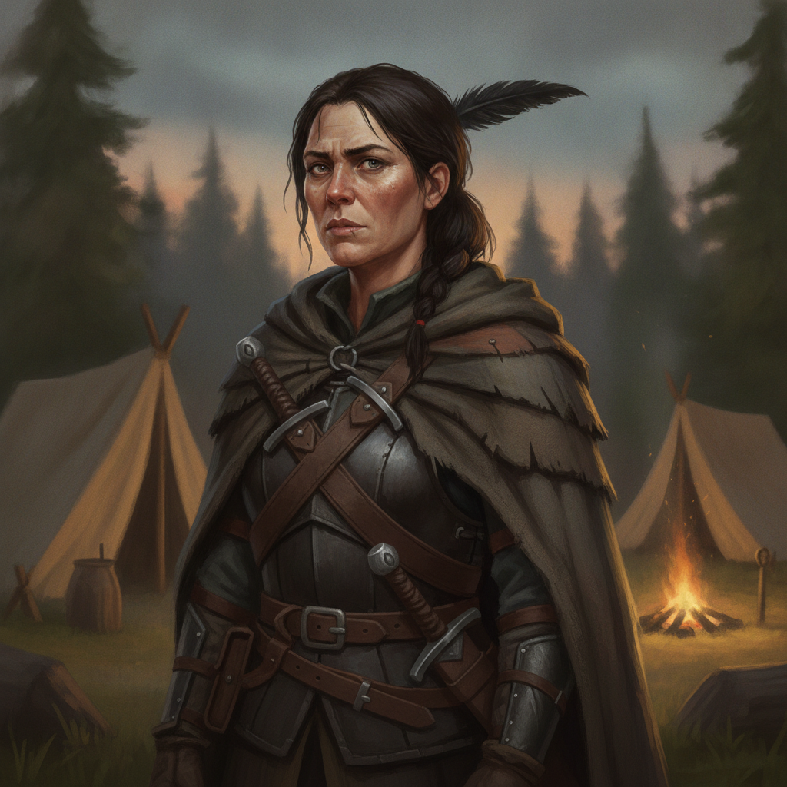

# Hanne „Krähe“

**Anführerin der Räuber im Mühlenwald.** Ehemalige Mühlenarbeiterin, führt die etwa 15 Tagelöhner, die nach der schlechten Ernte im Nachbartal zu Räubern wurden. Ihre Leute überfallen Kutschen und klauen Börsen, Würste und Nägel, aber sie haben nie jemanden getötet. Ergibt sich nach den ersten Toten. Seit sie vor einer Woche einen grauen Pilger ausrauben wollte, in dessen Ärmel etwas Schwarzes glänzte, hat sie Albträume von Spiegeln. Werte: RK 13, TP 22, zwei Angriffe.

→ `Story/Erzaehler/01-Das-Fest.md`, `Story/Erzaehler/00b-Der-Weg-nach-Thalendor.md`
