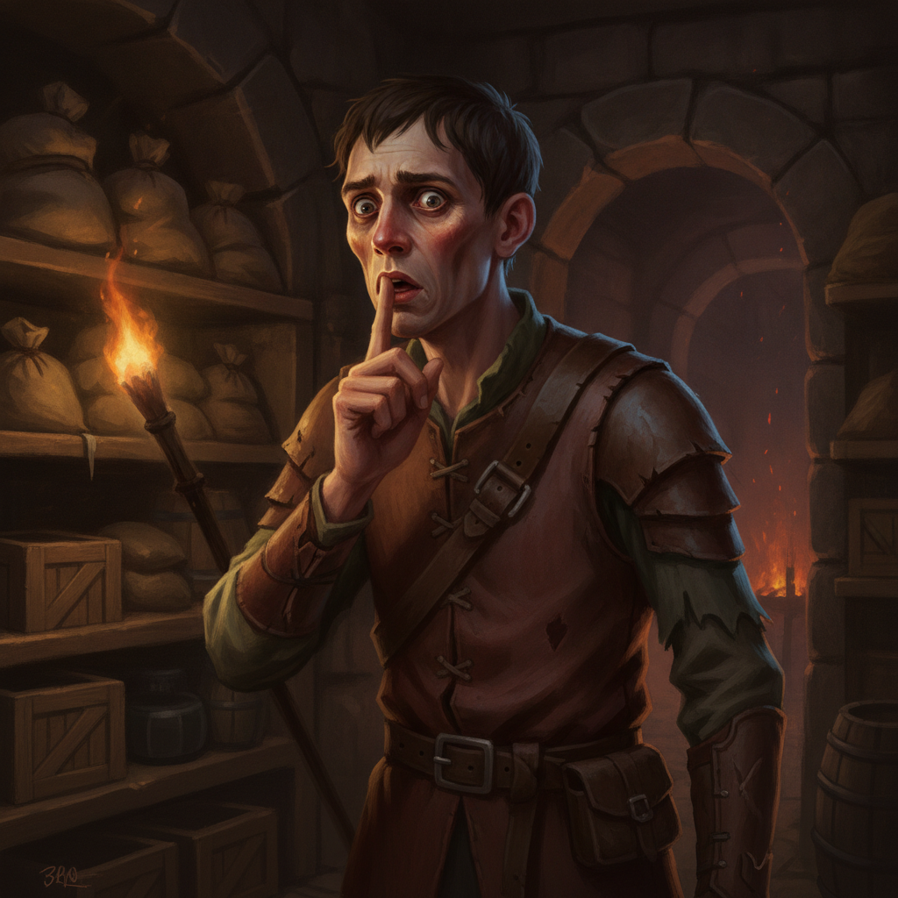

# Jannik

**Der Überlebende der Kompanie der Salzklingen.** Der Jüngste der zwanzig Abenteurer, die in der Hammerfeste verschwanden, Grims Neffe. Lebt seit sechs Wochen in der Vorratskammer der Feste von Flechten und Tropfwasser, abgemagert, halb von Sinnen, flüstert nur noch: „Nicht laut. Nie laut. Der Berg hört.“ Weiß, dass der Troll Feuer hasst, kennt die Blasebälge und warnt vor „dem Großen vor der Tür“. Eine Last und eine Hilfe; ihn heimzubringen ist die schönste Szene in Baldir. Werte als Kundschafter, Stufe 3.

→ `Dungeon/Hammerfeste-Grauhorn/Beschreibung.md`, `Story/Erzaehler/06-Dungeon-Hammerfeste.md`
