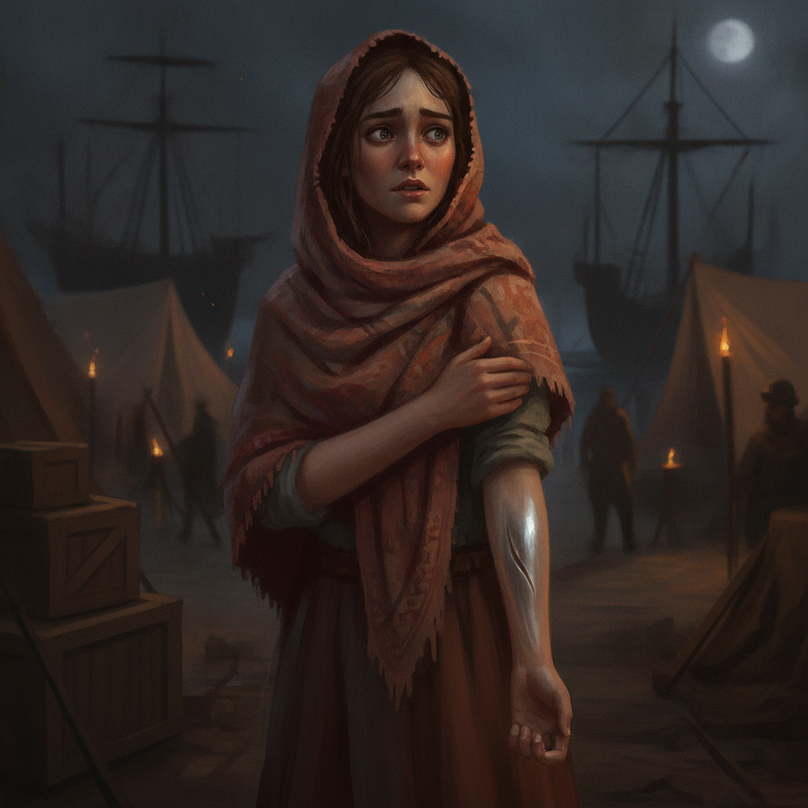

# Jola, die Gespiegelte

**Flüchtlingsfrau im Lager am Nordkai.** Aus einem Dorf nahe Thalendor; hat die wachsende Kuppel berührt und überlebt, mit einer spiegelglatten Brandnarbe am Arm. Abergläubische wollen sie aus Baldir werfen. Die Narbe ist harmlos, aber bei Kerzenlicht sieht man darin einen Wimpernschlag lang die Festhalle von Thalendor, von innen, heute: ein Fenster auf Vorgazhul, einmal nutzbar vor dem Finale.

→ `Quests/Nebenquest-Die-Gespiegelte.md`
