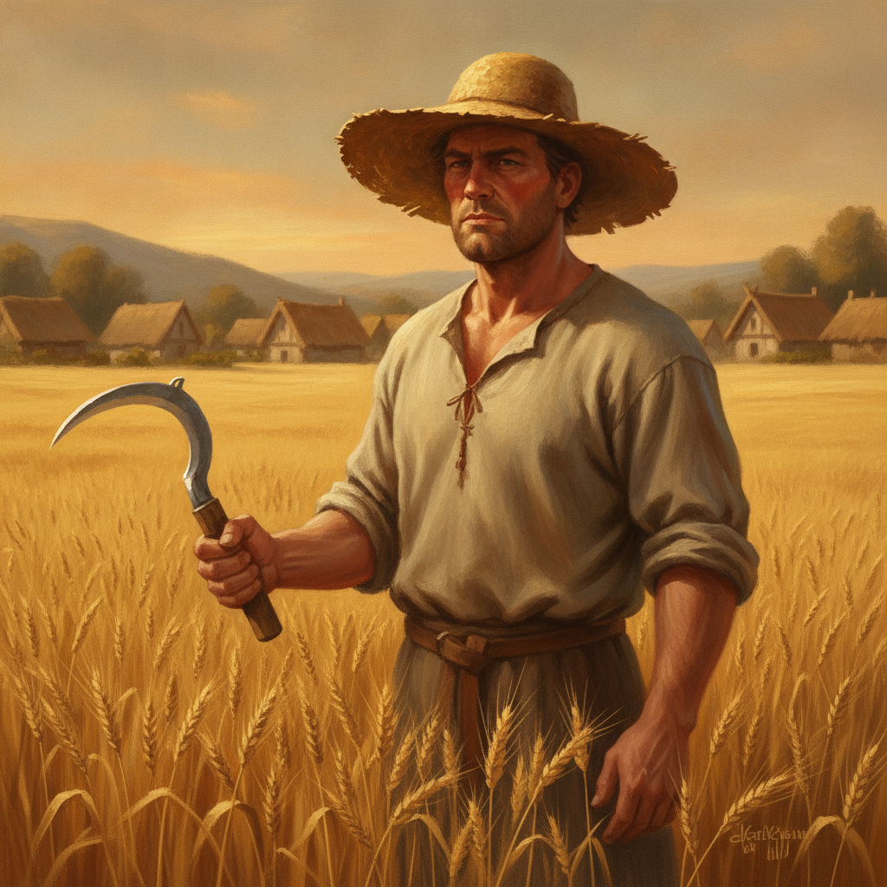

# Jorin

**Oma Wenkes Sohn.** Ende dreißig, breite Schultern, Strohhut, redet wenig: drei Sätze, mehr gibt es nicht. Bringt mit zwei Knechten die Gerste auf den Feldern westlich von Hirsefurt ein und geht nicht zum Fest, „sonst frisst das Wetter die halbe Ernte“. Hat vorgestern vier Gestalten am Waldrand gesehen, der einzige echte Hinweis auf das Räuberlager.

→ `Story/Erzaehler/00-Vorspiel-Hirsefurt.md`
