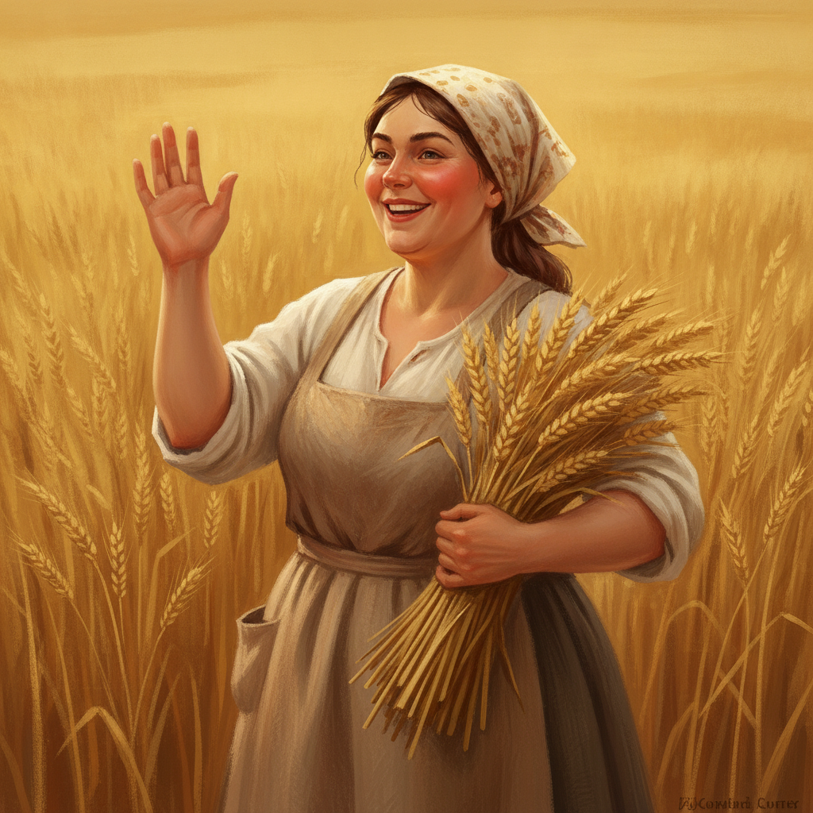

# Liese

**Oma Wenkes Tochter.** Ein paar Jahre jünger als Jorin und mit dem Mundwerk der Mutter: redet für zwei, winkt, wenn man winkt, und bestätigt alles, was Wenke sagt. Arbeitet mit dem Bruder auf dem Feld. Schickt die Helden lachend zum Fest: „Einer von uns muss schließlich wissen, wie das Freibier war, und Jorin erzählt ja nichts.“

→ `Story/Erzaehler/00-Vorspiel-Hirsefurt.md`
