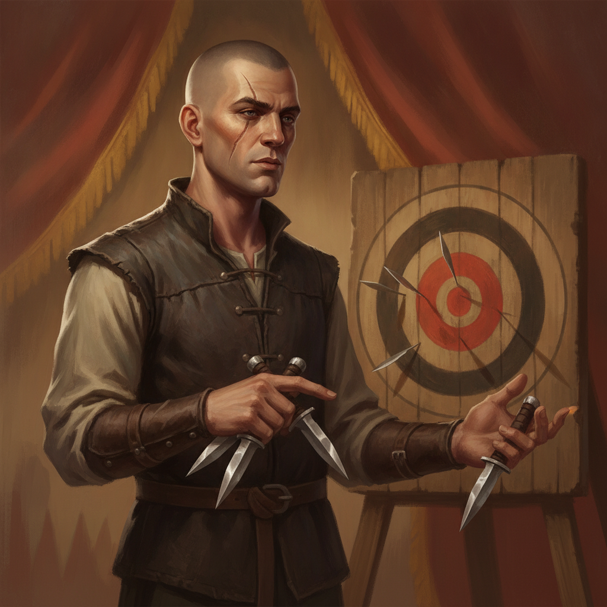

# Messerwerfer Berro

**Wanderzirkus Flimm.** Groß, Narbe im Gesicht, stumm: spricht nur mit den Händen. Hält bei „Zillis Seil“ die Leiter und wirft in der Vorstellung Messer. Ein ruhiger Riese, der nichts erklärt und alles mitbekommt.

→ `Story/Erzaehler/01b-Festspiele.md`
