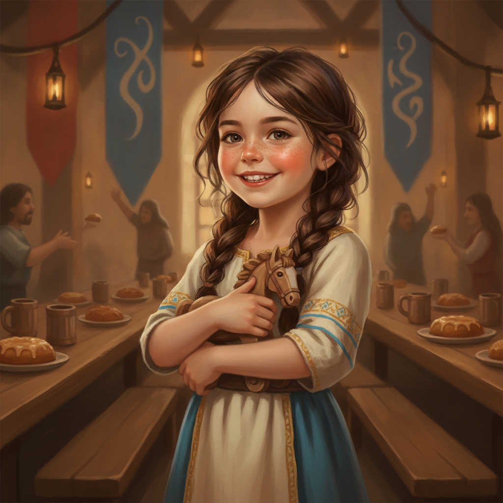

# Mira

**Theas Tochter, das Mädchen mit dem Holzpferd.** Sieben Jahre alt, Sommersprossen, Zahnlücke, und ein Holzpferd namens „Hafer“, das sie nie loslässt. Sitzt beim Überfall auf dem Kutschbock, schreit nicht, starrt nur, und hält den Helden danach das Pferd hin: „Hafer hatte keine Angst.“ Läuft den Helden den ganzen Festtag hinterher und abends allein zwischen den Tischen herum, weil die Mutter ausschenkt. Sie ist das Kind, das Malrik im Ritual opfert. Je mehr die Spieler sie mögen, desto härter trifft es sie. Flüstert, wenn niemand den Kultisten findet: „Der Mann in Grau hat gar kein Gesicht.“

→ `Story/Erzaehler/00b-Der-Weg-nach-Thalendor.md`, `Story/Erzaehler/01-Das-Fest.md`, `Story/Erzaehler/02-Ritual-und-Daemon.md`
