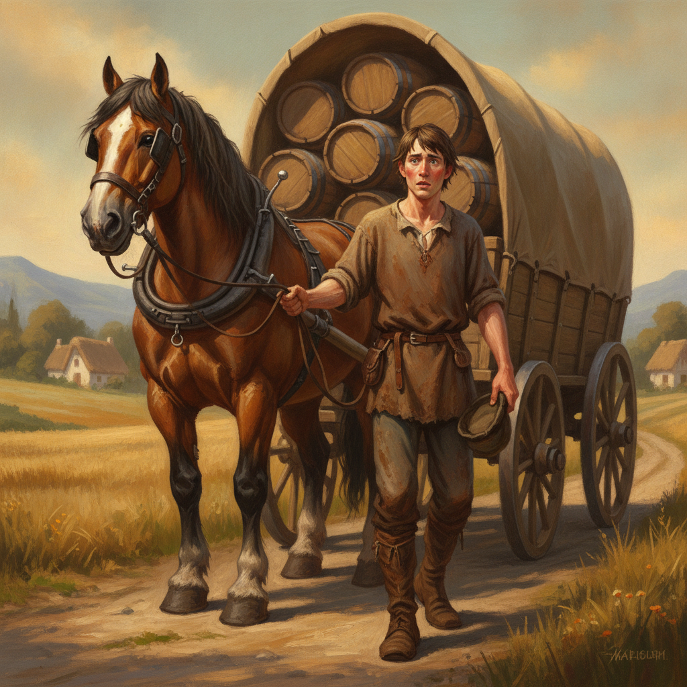

# Ole

**Theas Fuhrknecht.** Neunzehn, hat zum ersten Mal die Zügel von Theas Bierkutsche und sieht nach dem Überfall aus, als würde er sie nie wieder anfassen. Steht beim Fest mit Thea an der Brauerei und stellt Krüge bereit; auf der offenen Bühne jongliert er mit drei Krügen und lässt einen fallen.

→ `Story/Erzaehler/00b-Der-Weg-nach-Thalendor.md`, `Story/Erzaehler/01b-Festspiele.md`
