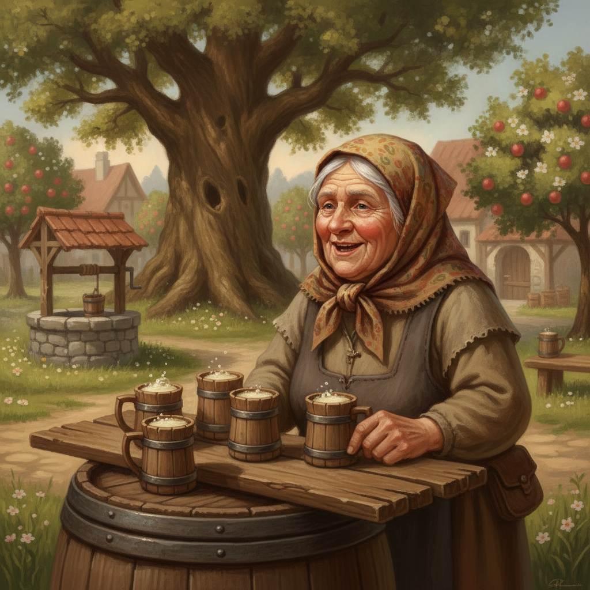

# Oma Wenke

**Moststand in Hirsefurt.** Die alte Mostfrau am Dorfplatz von Hirsefurt: ein Fass, ein Brett, zwei Kupfer der Becher. Erzählt gern, dass „die ganze Jugend nach Thalendor gelaufen ist, wegen dem Fest“, und dass sich der Umweg schon für das Dunkelbier lohnt. Bleibt selbst zu Hause, weil ihre Kinder Jorin und Liese das Korn einbringen und abends das Essen auf dem Tisch stehen muss. Weiß, dass die Räuber „im Wald hinter den Mühlen“ sitzen.

→ `Story/Erzaehler/00-Vorspiel-Hirsefurt.md`
