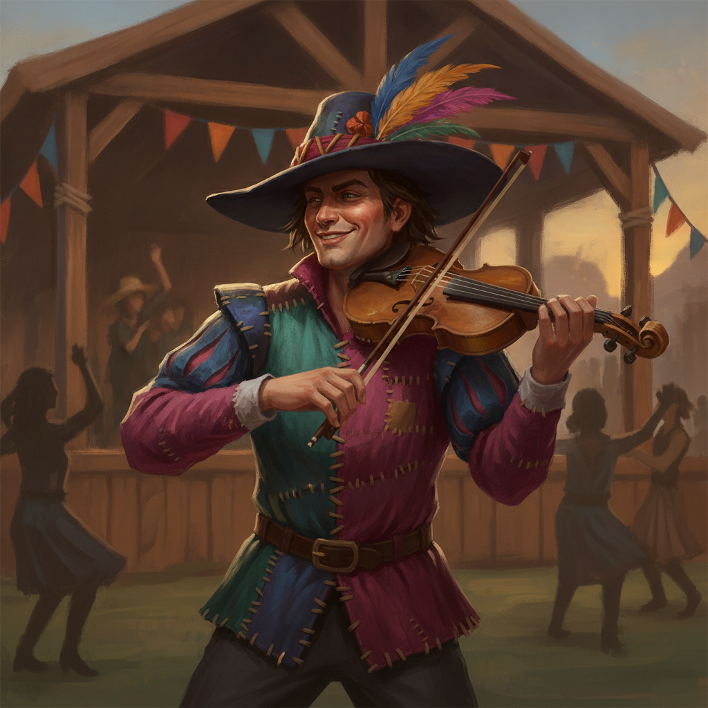

# Spielmann Jost

**Anführer der Musikanten.** Spielt mit seinen Musikanten tagsüber in den Lindenalleen, ruft um 14 Uhr an der Bühne auf dem Festplatz die Nummern aus und spielt abends in der Festhalle zum Großen Festtanz. Freundlich, laut, spielt jeden, der auf der Bühne scheitert, höflich wieder hinunter. Während des Tanzes hört man zwischen seinen Liedern den Dorfklatsch, auch über den grauen Pilger in Zimmer 4.

→ `Story/Erzaehler/01b-Festspiele.md`
