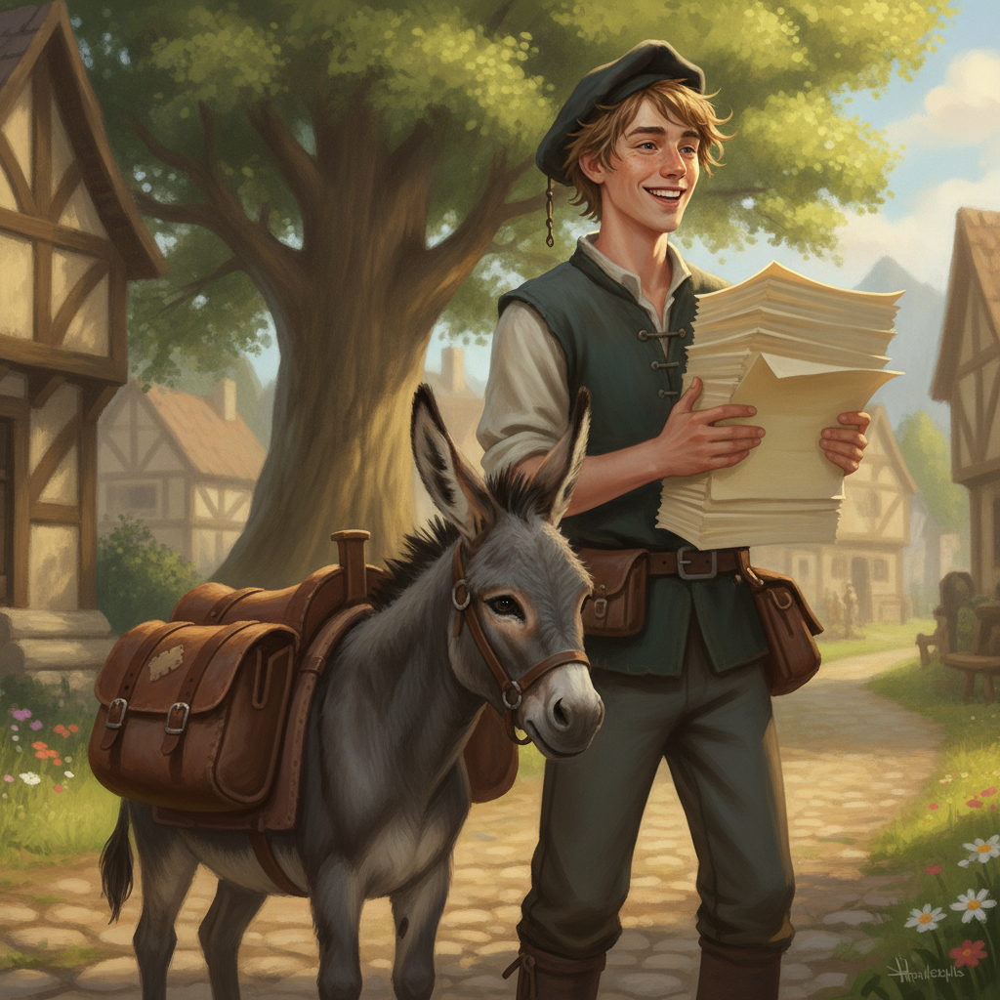

# Tamo

**Baldrics Neffe, der Flyer-Bote.** Ende zwanzig, schlaksig, Sommersprossen, eine viel zu große Mütze, mehr Begeisterung als Würde, unterwegs auf einem Esel mit zwei Satteltaschen voller Festflyer. Verteilt seit Tagen in allen Dörfern rund um Sommerhall die Einladung zum Fest der Goldenen Ähre und ist mächtig stolz darauf; wer „Rabenpass“ sagt, hat ihn für immer als Fan. Schreibt den Helden in Hirsefurt eine Notiz für Tante Alma auf den Flyer („Bett in der Sichel!“) und sitzt am Festnachmittag vorne an der Bühne auf seinem Esel.

→ `Story/Erzaehler/00-Vorspiel-Hirsefurt.md`, `Story/Erzaehler/01b-Festspiele.md`
