# NPCs auf einen Blick

Alle Nichtspielercharaktere der Kampagne, in der Reihenfolge, in der die Helden ihnen begegnen. Zu jedem: das Bild, dann ein paar Sätze. Mehr steht in `Beschreibung.md` im jeweiligen Ordner (Baldric, Phae und Nerida haben zusätzlich `Stats/` und `Faehigkeiten/`). Die Figuren der Sci-Fi-Arena stehen in `Spezial-Event/Sci-Fi-Arena/NPC/`.

## Hirsefurt (Vorspiel)

### Oma Wenke

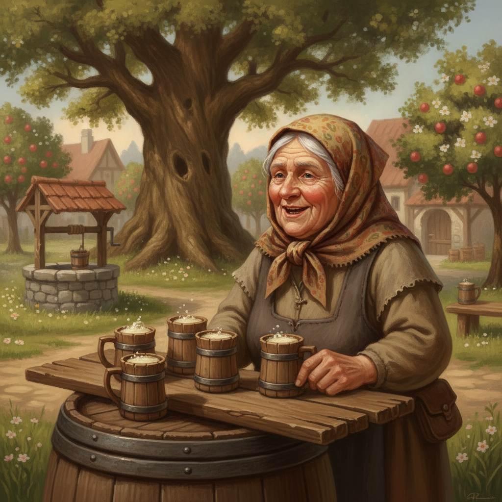

**Moststand in Hirsefurt.** Die alte Mostfrau am Dorfplatz von Hirsefurt: ein Fass, ein Brett, zwei Kupfer der Becher. Erzählt gern, dass „die ganze Jugend nach Thalendor gelaufen ist, wegen dem Fest“, und dass sich der Umweg schon für das Dunkelbier lohnt. Bleibt selbst zu Hause, weil ihre Kinder Jorin und Liese das Korn einbringen und abends das Essen auf dem Tisch stehen muss. Weiß, dass die Räuber „im Wald hinter den Mühlen“ sitzen.

### Jorin

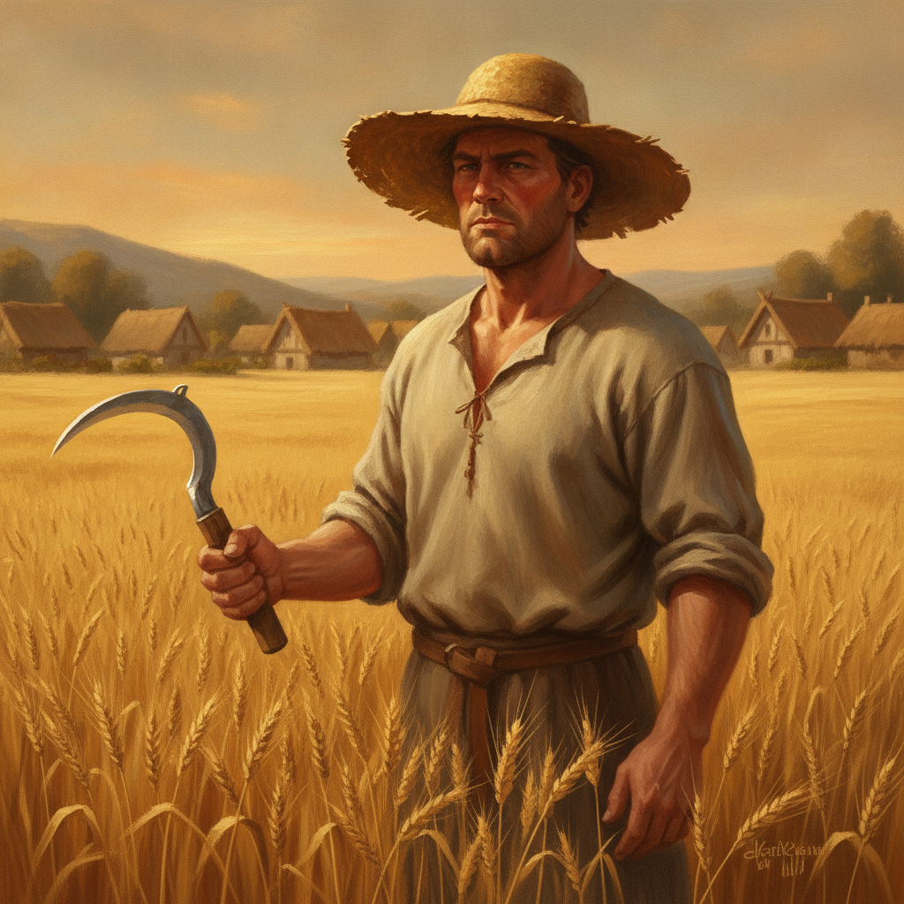

**Oma Wenkes Sohn.** Ende dreißig, breite Schultern, Strohhut, redet wenig: drei Sätze, mehr gibt es nicht. Bringt mit zwei Knechten die Gerste auf den Feldern westlich von Hirsefurt ein und geht nicht zum Fest, „sonst frisst das Wetter die halbe Ernte“. Hat vorgestern vier Gestalten am Waldrand gesehen, der einzige echte Hinweis auf das Räuberlager.

### Liese

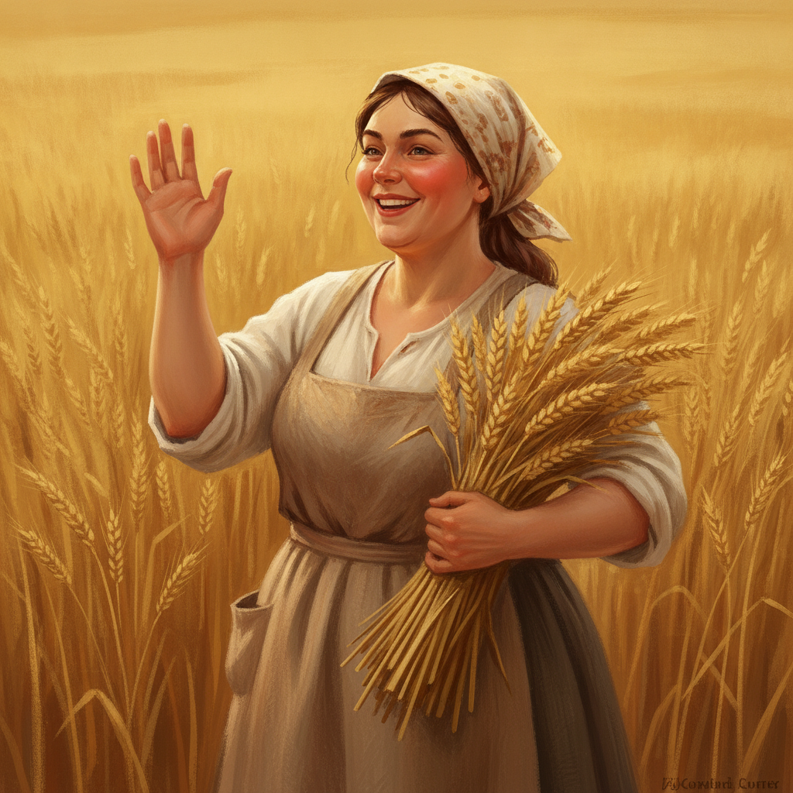

**Oma Wenkes Tochter.** Ein paar Jahre jünger als Jorin und mit dem Mundwerk der Mutter: redet für zwei, winkt, wenn man winkt, und bestätigt alles, was Wenke sagt. Arbeitet mit dem Bruder auf dem Feld. Schickt die Helden lachend zum Fest: „Einer von uns muss schließlich wissen, wie das Freibier war, und Jorin erzählt ja nichts.“

### Tamo

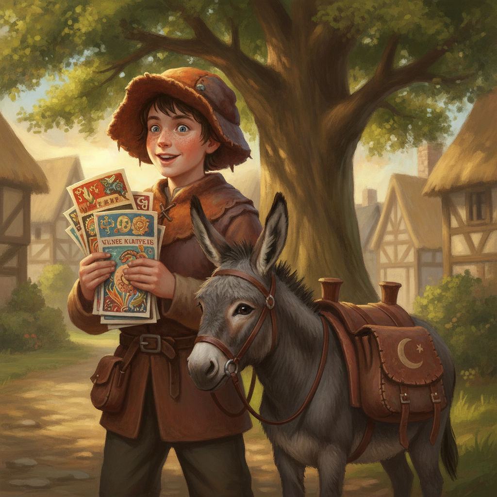

**Baldrics Neffe, der Flyer-Bote.** Ende zwanzig, schlaksig, Sommersprossen, eine viel zu große Mütze, mehr Begeisterung als Würde, unterwegs auf einem Esel mit zwei Satteltaschen voller Festflyer. Verteilt seit Tagen in allen Dörfern rund um Thalendor die Einladung zum Fest der Goldenen Ähre und ist mächtig stolz darauf; wer „Rabenpass“ sagt, hat ihn für immer als Fan. Schreibt den Helden in Hirsefurt eine Notiz für Tante Alma auf den Flyer („Bett in der Sichel!“) und sitzt am Festnachmittag vorne an der Bühne auf seinem Esel.

## Thalendor

### Hauptmann Baldric Immergrün

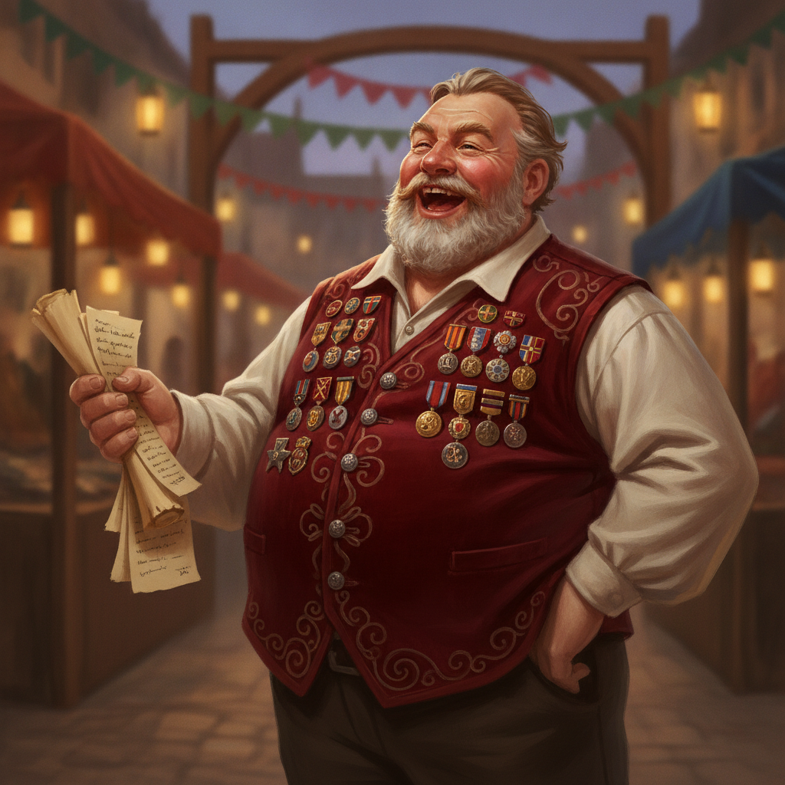

**Hauptmann der Stadtwache von Thalendor und Ausrichter des Fests.** Rundlich, rotwangig, Weste voller Ehrennadeln, dröhnendes Lachen; führt seit zwanzig Jahren mit Stimme und Listen statt mit dem Schwert und kennt jeden Namen in der Stadt. Macht die Helden zu Ehrengästen, eröffnet die Festspiele, und greift beim Ritual den Dämon ohne Rüstung an, um Gäste zu schützen: Er stirbt an seinem eigenen, reflektierten Schlag. Im zweiten Durchlauf der wichtigste Verbündete für die Evakuierung.

### Wirtin Alma

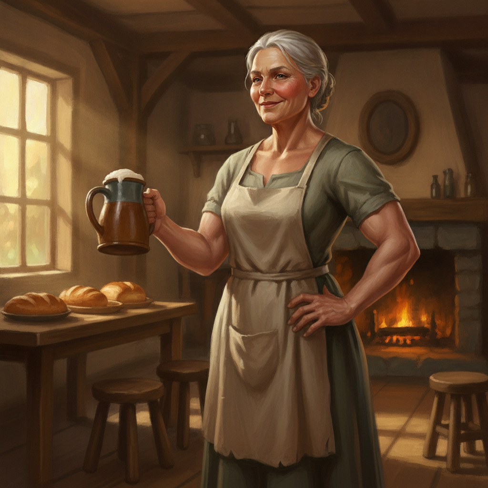

**Gasthaus „Zur Sichel“, Thalendor.** Mütterlich und resolut, Herz aus Gold, Arme wie ein Schmied; nennt alle „Kind“, auch den Barbaren. Führt das Gasthaus „Zur Sichel“, in dem die Helden als Ehrengäste schlafen und nach dem Traum wieder aufwachen. Ist Tamos Tante und weiß, dass der graue Pilger in Zimmer 4 nie isst. Stirbt Baldric, übernimmt sie seine Rolle als Anführerin der Geflüchteten vor der Kuppel.

### Brauerin Thea Glutfaust

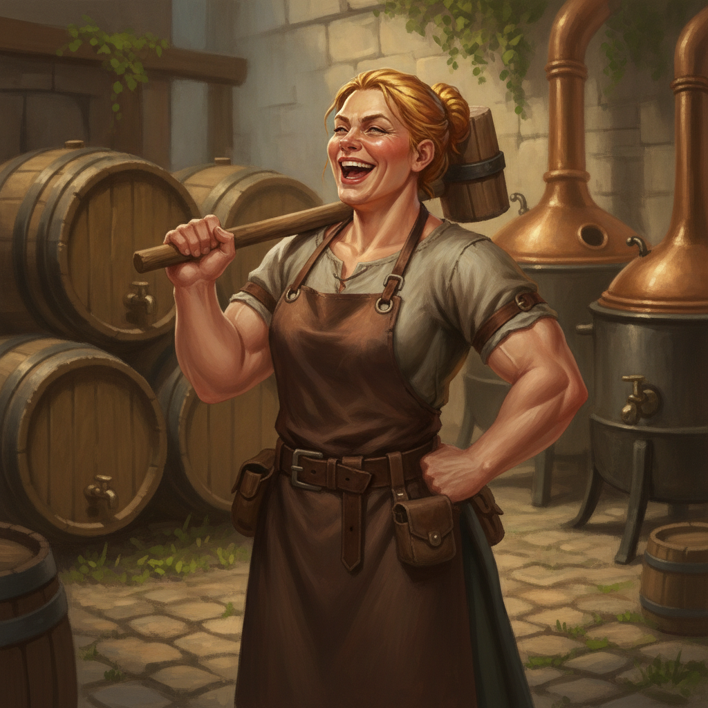

**Brauerei im Westen von Thalendor.** Mitte vierzig, Arme wie Fässer, Stimme wie ein Zapfhahn, lacht laut und flucht lauter. Ihr gehört die Brauerei; ihr Jahrgangs-Dunkelbier („das gute Zeug“) gibt es nur abends in der Festhalle, und die Helden retten es auf dem Weg nach Thalendor vor Räubern. Haut im Kampf selbst mit (Schlegel +4, 1W8+2). Steht am Festabend am Ausschank, schlägt beim „Anstich“ das erste Fass an und zeigt dem besten Werfer die Kellertreppe hinter dem Ausschank. Mutter von Mira; bei der Evakuierung ein Verbündeter mit Stimme.

### Mira

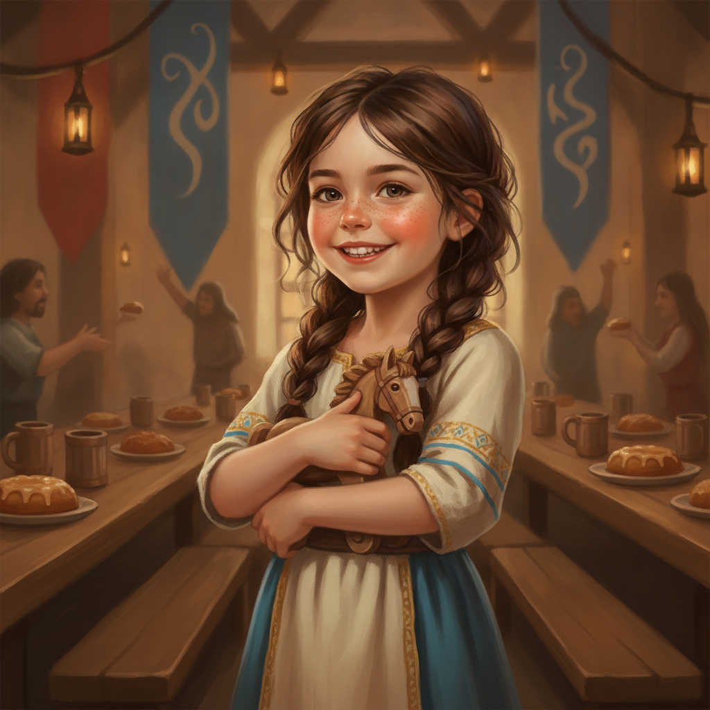

**Theas Tochter, das Mädchen mit dem Holzpferd.** Sieben Jahre alt, Sommersprossen, Zahnlücke, und ein Holzpferd namens „Hafer“, das sie nie loslässt. Sitzt beim Überfall auf dem Kutschbock, schreit nicht, starrt nur, und hält den Helden danach das Pferd hin: „Hafer hatte keine Angst.“ Läuft den Helden den ganzen Festtag hinterher und abends allein zwischen den Tischen herum, weil die Mutter ausschenkt. Sie ist das Kind, das Malrik im Ritual opfert. Je mehr die Spieler sie mögen, desto härter trifft es sie. Flüstert, wenn niemand den Kultisten findet: „Der Mann in Grau hat gar kein Gesicht.“

### Ole

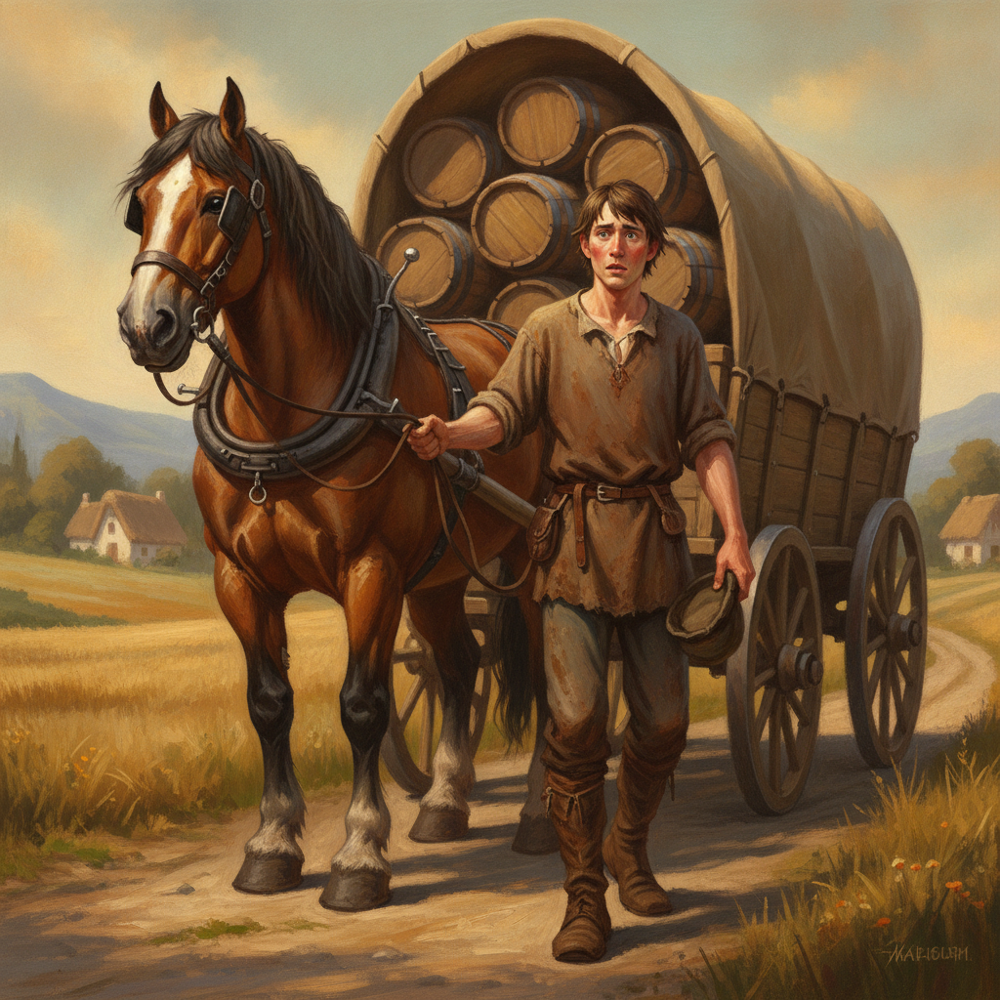

**Theas Fuhrknecht.** Neunzehn, hat zum ersten Mal die Zügel von Theas Bierkutsche und sieht nach dem Überfall aus, als würde er sie nie wieder anfassen. Steht beim Fest mit Thea an der Brauerei und stellt Krüge bereit; auf der offenen Bühne jongliert er mit drei Krügen und lässt einen fallen.

### „Eisenhand“ Grom

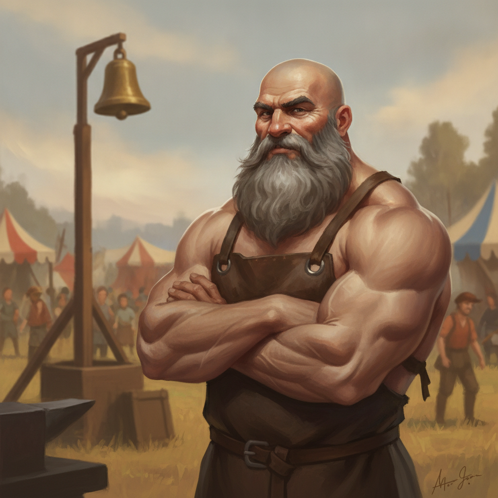

**Schmied von Thalendor.** Der Schmied der Stadt, ungeschlagen im Armdrücken (würfelt mit +6), Hände wie Schraubstöcke. Steht beim „Hau den Lukas“ mit verschränkten Armen und kommentiert knapp („Beinahe. Beinahe ist gut.“), brummt auf der Bühne eine Strophe Schmiedelied. Wer ihn am Abend im Armdrücken schlägt, hat einen Freund fürs Leben. Beim Ritual schwingt er seinen Hammer gegen den Dämon, wenn ihn niemand abhält; fehlt Baldric, ist er der heldenhafte Angreifer, der an seinem eigenen Schlag stirbt.

### Spielmann Jost

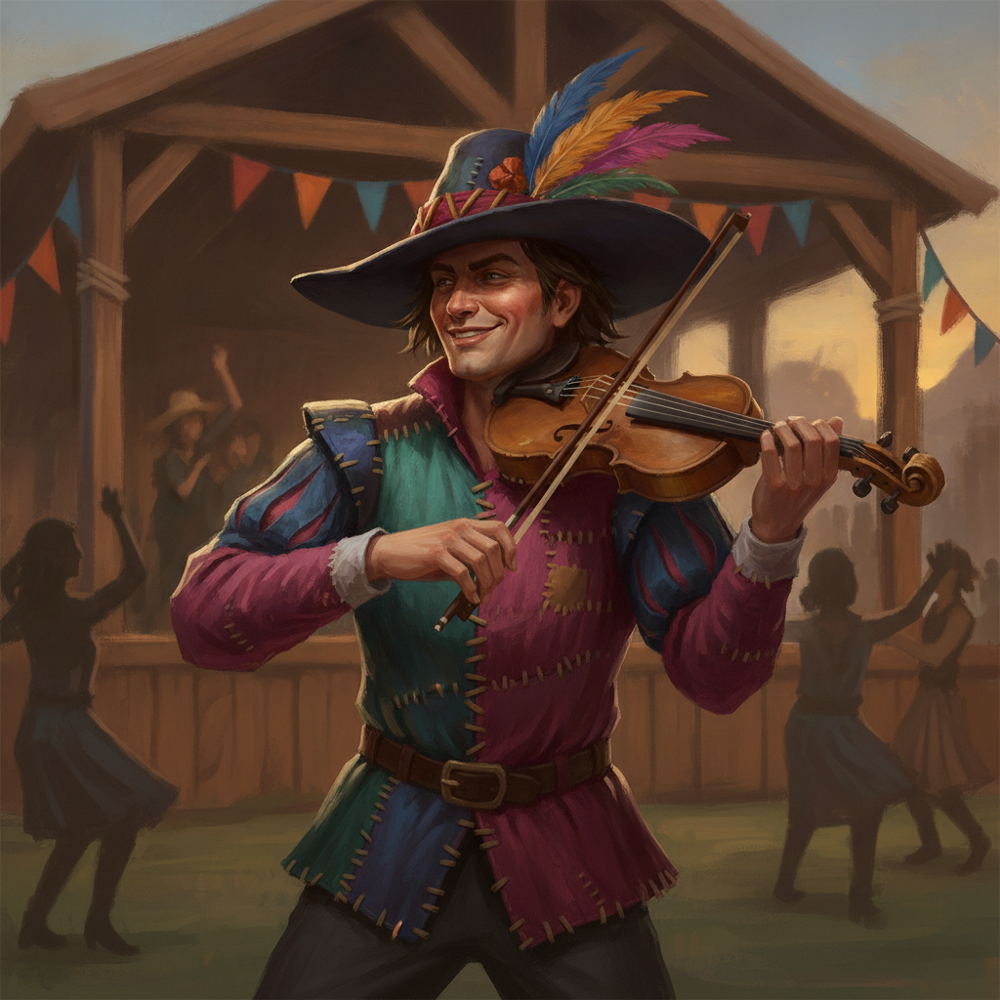

**Anführer der Musikanten.** Spielt mit seinen Musikanten tagsüber in den Lindenalleen, ruft um 14 Uhr an der Bühne auf dem Festplatz die Nummern aus und spielt abends in der Festhalle zum Großen Festtanz. Freundlich, laut, spielt jeden, der auf der Bühne scheitert, höflich wieder hinunter. Während des Tanzes hört man zwischen seinen Liedern den Dorfklatsch, auch über den grauen Pilger in Zimmer 4.

### Die Weise Frau Henna

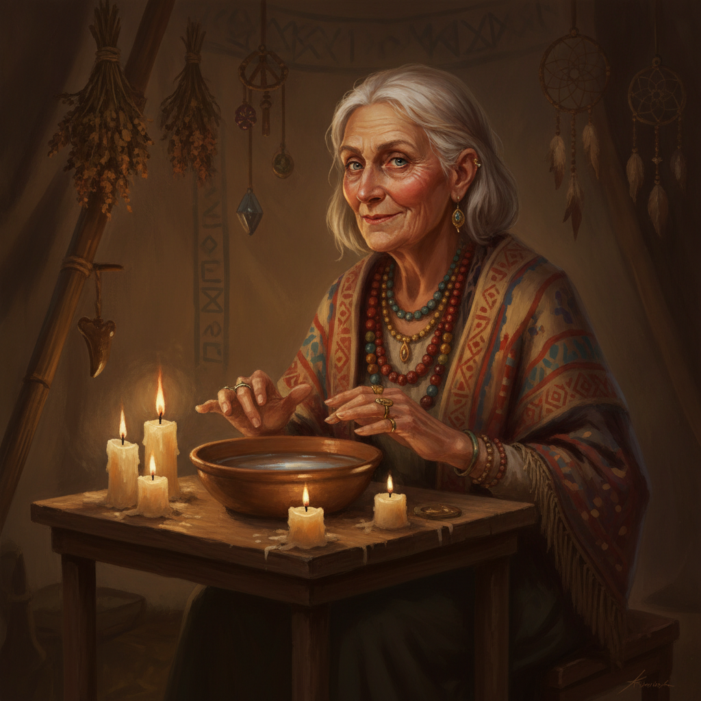

**Wahrsagerin am Markt.** Sitzt in ihrem Wahrsagerzelt zwischen den Ständen am Brunnen und weiß mehr, als sie sagt. Kein Spiel, kein Wurf: nur eine Stimme für Gruppen, die straucheln. Im zweiten Durchlauf sagt sie der erinnernden Person: „Ein Traum kommt nie zweimal durch dieselbe Tür.“

### Der Flinke Pit

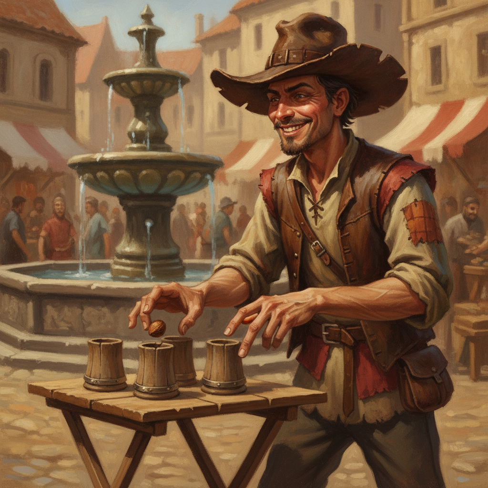

**Hütchenspieler am Brunnen.** Kein Thalendorer, nur zum Fest in der Stadt: ein Klapptisch am Brunnenrand, drei Becher, eine Nuss, ein Silber Einsatz. Schiebt die Nuss in den Ärmel und klaut bei schlechten Würfen gleich noch den Geldbeutel. Wer ihn erwischt, bekommt von Baldric lachend seinen Hut mit 15 Gold Kleingeld, den Einsätzen des Tages.

### Direktor Ottokar Flimm

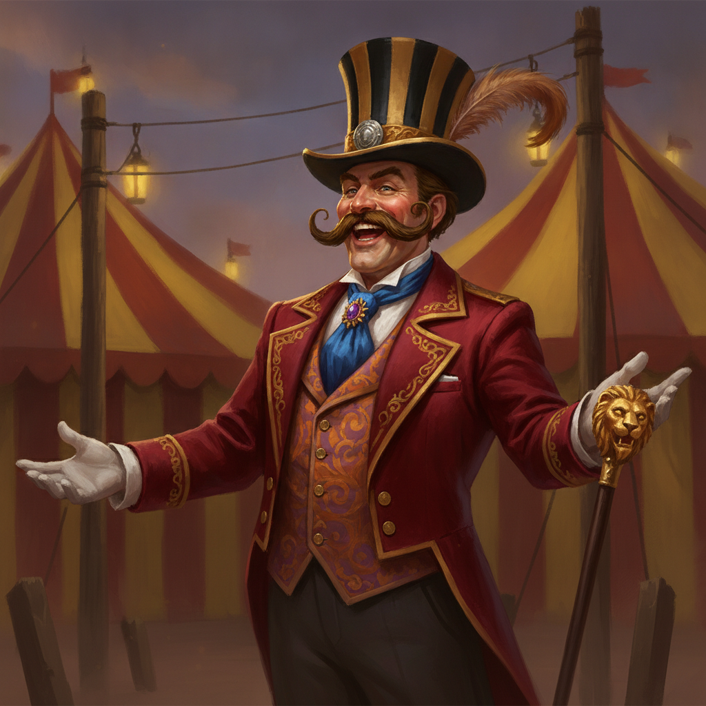

**Wanderzirkus Flimm.** Zylinder, Schnauzbart, redet ohne Punkt und Komma. Sein gelbes Zirkuszelt steht beim Fest auf dem Festplatz, davor das Seil für „Zillis Seil“. Trommelt Gäste zusammen und feiert jeden Mutigen („Ein Applaus für den Mut!“). Nimmt Valerian Quecks seit zwölf Jahren mit, „weil er pünktlich zahlt“. Der Zirkus reist am Morgen nach dem Fest ab; im zweiten Durchlauf können seine Wagen bei der Evakuierung Dutzende Menschen mitnehmen.

### Seiltänzerin Zilli

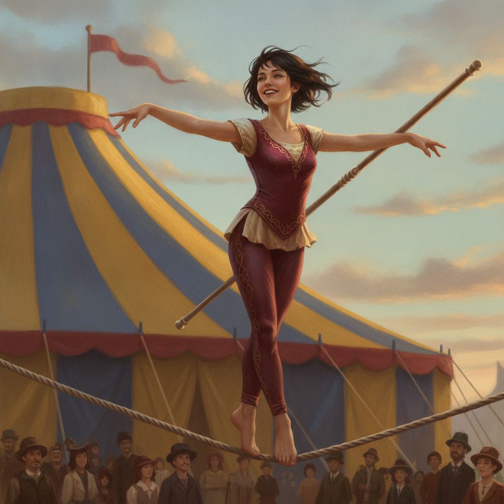

**Wanderzirkus Flimm.** Schmal, barfuß, sagt wenig und grinst viel. Tanzt zur Vorführung über das Seil in vier Metern Höhe, als sei es ein Gehweg, und hilft jedem aus dem Netz, der es nicht schafft. Wer mit einem Salto vom Seil kommt, bekommt von ihr ernsthaft eine Anstellung angeboten: „Wir brechen morgen früh auf.“

### Messerwerfer Berro

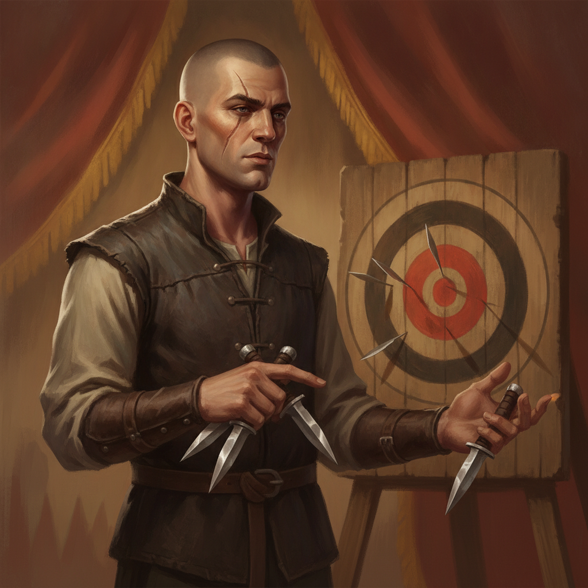

**Wanderzirkus Flimm.** Groß, Narbe im Gesicht, stumm: spricht nur mit den Händen. Hält bei „Zillis Seil“ die Leiter und wirft in der Vorstellung Messer. Ein ruhiger Riese, der nichts erklärt und alles mitbekommt.

### Hanne „Krähe“

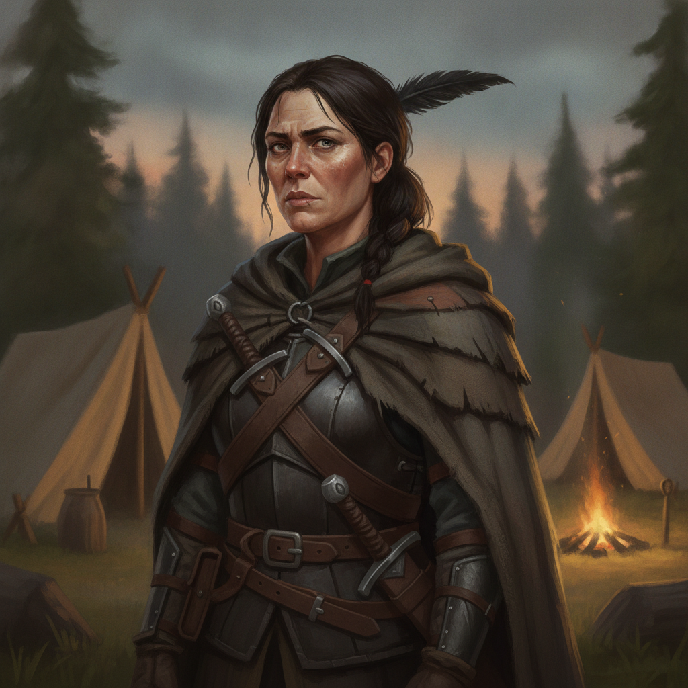

**Anführerin der Räuber im Mühlenwald.** Ehemalige Mühlenarbeiterin, führt die etwa 15 Tagelöhner, die nach der schlechten Ernte im Nachbartal zu Räubern wurden. Ihre Leute überfallen Kutschen und klauen Börsen, Würste und Nägel, aber sie haben nie jemanden getötet. Ergibt sich nach den ersten Toten. Seit sie vor einer Woche einen grauen Pilger ausrauben wollte, in dessen Ärmel etwas Schwarzes glänzte, hat sie Albträume von Spiegeln. Werte: RK 13, TP 22, zwei Angriffe.

## Nach der Flucht

### Phae, das Sternenlicht

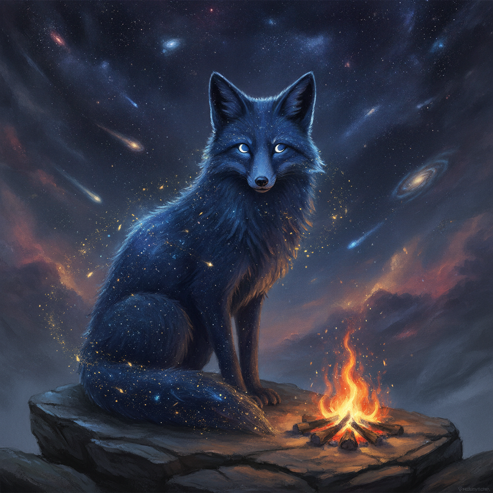

**Das magische Wesen nach der Flucht.** Ein Fuchs aus Sternenlicht und Nachthimmel, die Augen zwei winzige Monde, Stimme wie Wind in Glockenspiel. Uralt, verspielt, lügt nie, kämpft nie. Erscheint genau dreimal (Lagerfeuer, Rückweg aus dem Grauhorn, nach dem Sieg), beantwortet je etwa drei Fragen und hat das eine Wunder der Kampagne; beim zweiten Treffen gibt es gegen ein ehrliches Angebot die Sternenglut. Was es wirklich ist, erfahren die Spieler nie: ein Rest von Serenyas stillem Eid.

## Baldir und das Grauhorn

### Archivarin Nerida

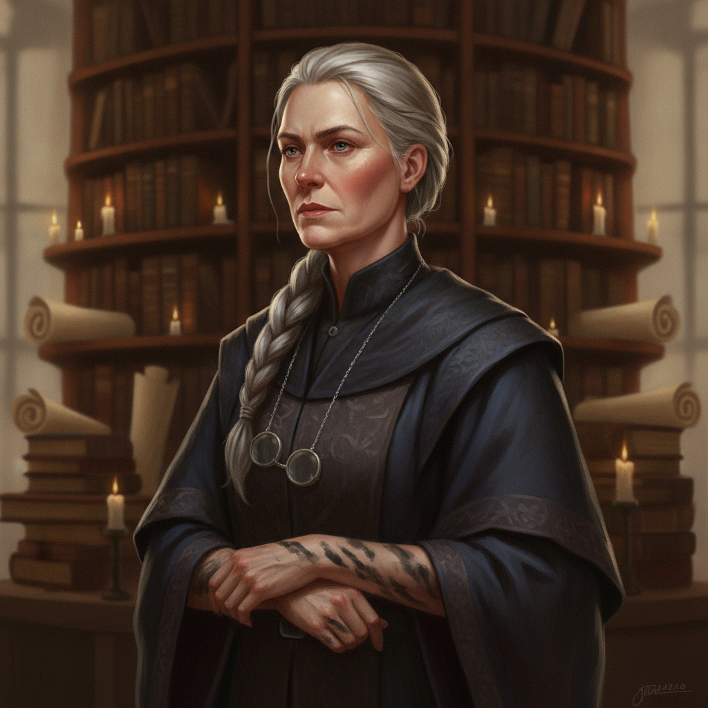

**Hüterin der Gezeitenarchive von Baldir, Questgeberin.** Mitte fünfzig, salzgraues Haar streng geflochten, Tintenflecken bis zum Ellbogen, Lesesteine an einer Kette. Leise, präzise, streng; ihre Schwester lebt in Thalendor. Muss erst einen halben Tag recherchieren, findet die 5.000 Jahre alten Steintafeln und begreift, dass die vor sechs Wochen gestohlenen Reliquien die einzigen Waffen gegen den Spiegelherrn sind. Gibt Festungsplan, Küstenkarte und auf hartnäckiges Nachfragen Runenlaterne und Steinhaut-Tränke.

### Fischer Grim

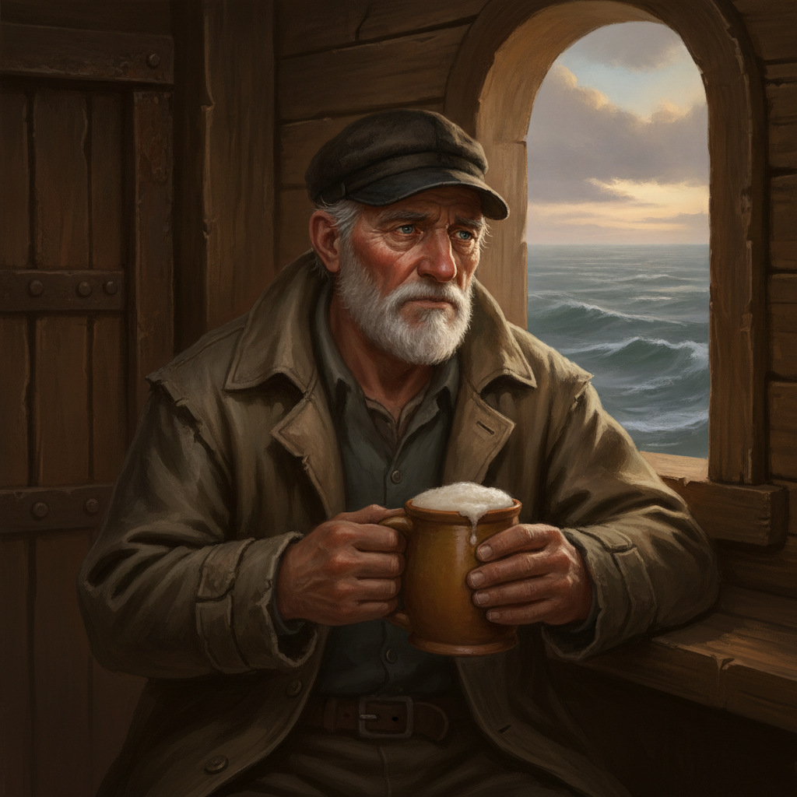

**Stammgast in der „Salzigen Möwe“, Baldir.** Alter Fischer mit Stammplatz am Fenster der Taverne. Erzählt für einen Krug vom Grauhorn: Sein Bruder sah die Diebe anlanden, lief ihnen bis zum Bergtor nach und kam ohne Stimme zurück. Sein Neffe Jannik war bei der verschollenen Kompanie der Salzklingen. Zeigt die Bucht unter dem Berg, bietet sein Boot an („Bringt wenigstens Jannik heim“) und rückt nach dem zweiten Krug Janniks Hakenseil heraus.

### Hafenmeisterin Brenka

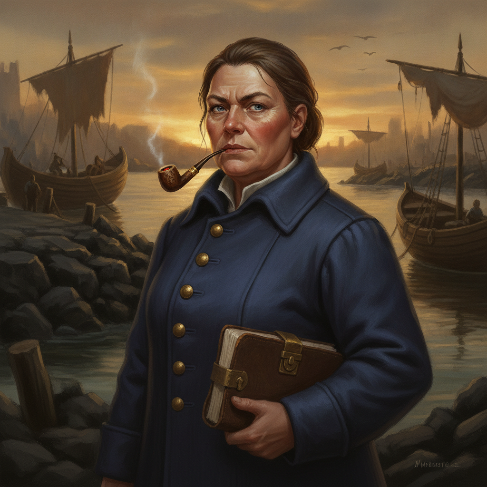

**Amtsstube am Kai von Baldir.** Pragmatisch, bestechlich mit gutem Tabak, weiß alles über ein- und auslaufende Schiffe und wer mit wem Ärger hat. Zahlt 50 Gold für Hinweise auf die Schmuggler von Aal-Lene; wer die Bande auffliegen lässt, bekommt ihren Dank, freie Bootsnutzung und die Feuerfässchen der Turmwache ohne Wurf.

### Jola, die Gespiegelte

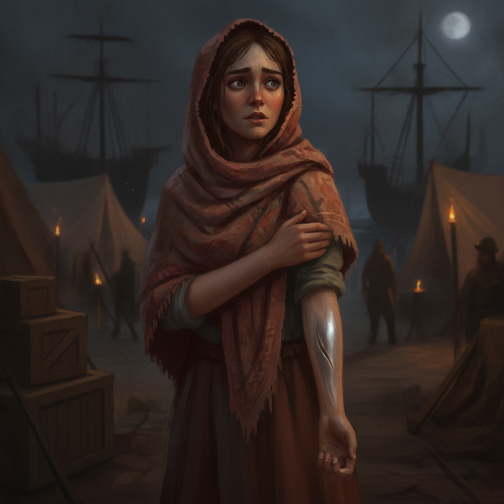

**Flüchtlingsfrau im Lager am Nordkai.** Aus einem Dorf nahe Thalendor; hat die wachsende Kuppel berührt und überlebt, mit einer spiegelglatten Brandnarbe am Arm. Abergläubische wollen sie aus Baldir werfen. Die Narbe ist harmlos, aber bei Kerzenlicht sieht man darin einen Wimpernschlag lang die Festhalle von Thalendor, von innen, heute: ein Fenster auf Vorgazhul, einmal nutzbar vor dem Finale.

### „Aal-Lene“

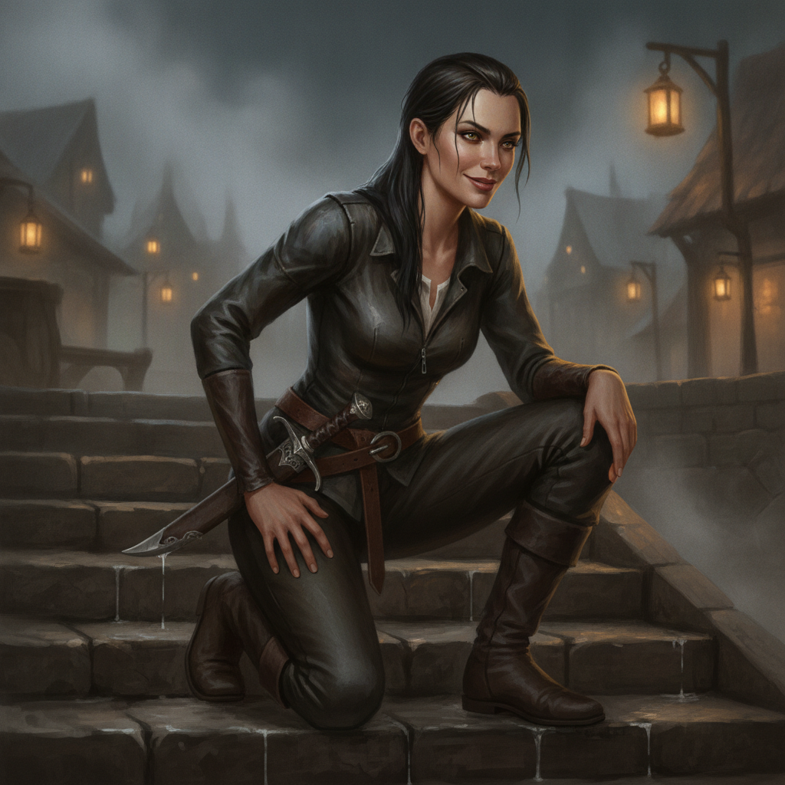

**Anführerin der Schmuggler von Baldir.** Gewandt, glatt, kennt jede Treppe der Stadt. Nutzt die Flüchtlingskrise, verkauft wertlose „Schutzamulette gegen den Spiegel“ und schmuggelt Salz und Waffen an der Hafensteuer vorbei; ihr Lager liegt in einer Felsnische auf halbem Weg zur Bucht unter dem Grauhorn. Gibt bei Druck auf, verrät das Lager und verschwindet mit der nächsten Flut. Werte wie ein Banditenhauptmann, Geschicklichkeit im Vordergrund.

### Jannik

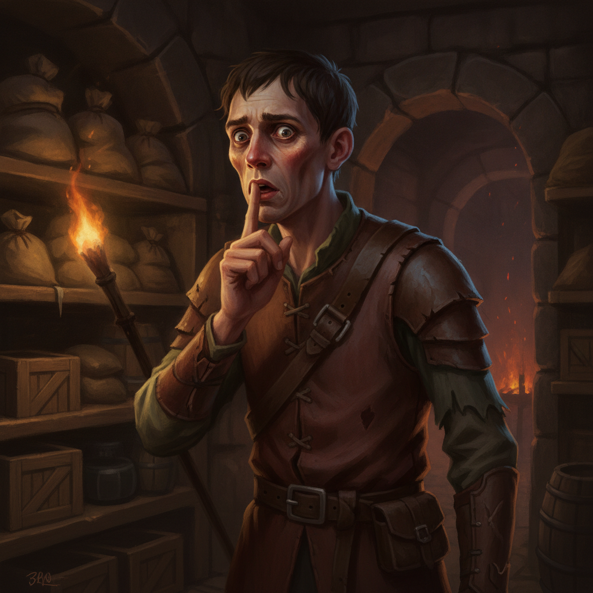

**Der Überlebende der Kompanie der Salzklingen.** Der Jüngste der zwanzig Abenteurer, die in der Hammerfeste verschwanden, Grims Neffe. Lebt seit sechs Wochen in der Vorratskammer der Feste von Flechten und Tropfwasser, abgemagert, halb von Sinnen, flüstert nur noch: „Nicht laut. Nie laut. Der Berg hört.“ Weiß, dass der Troll Feuer hasst, kennt die Blasebälge und warnt vor „dem Großen vor der Tür“. Eine Last und eine Hilfe; ihn heimzubringen ist die schönste Szene in Baldir. Werte als Kundschafter, Stufe 3.

### Bruder Edrik

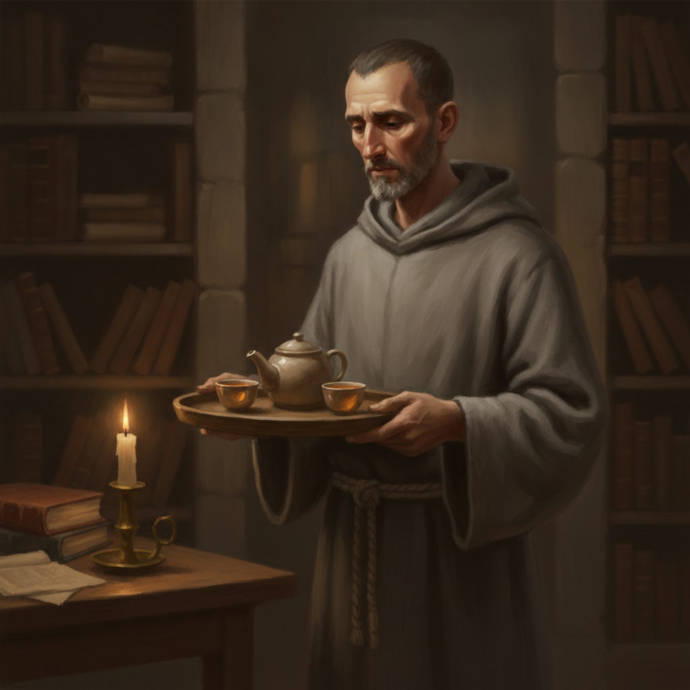

**Der Dieb der Vier Reliquien.** Stiller, zuverlässiger Archivgehilfe, der über ein Jahr lang im Gezeitenturm arbeitete und Neridas Vertrauen hatte. In der Nacht der tiefsten Ebbe mischte er den Turmwächtern Schlafmohn in den Tee, öffnete das Gewölbe der Vier und reichte die Reliquien durch den Flutkanal an vier Kultisten im Boot. Sein Tagebuch nennt „den Meister in den Kornfeldern“ (Malrik). Die Helden treffen ihn nicht mehr lebend: Die Diebe schlossen sich in der Tresorkammer der Hammerfeste vor Gorrum ein und verdursteten.
