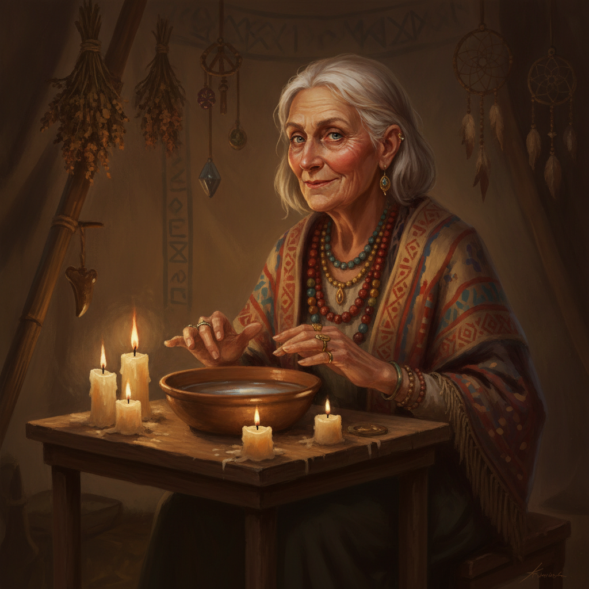

# Die Weise Frau Henna

**Wahrsagerin am Markt.** Sitzt in ihrem Wahrsagerzelt zwischen den Ständen am Brunnen und weiß mehr, als sie sagt. Kein Spiel, kein Wurf: nur eine Stimme für Gruppen, die straucheln. Im zweiten Durchlauf sagt sie der erinnernden Person: „Ein Traum kommt nie zweimal durch dieselbe Tür.“

→ `Stadt/Thalendor/Beschreibung.md`, `Story/Erzaehler/03-Traum-und-Neustart.md`
