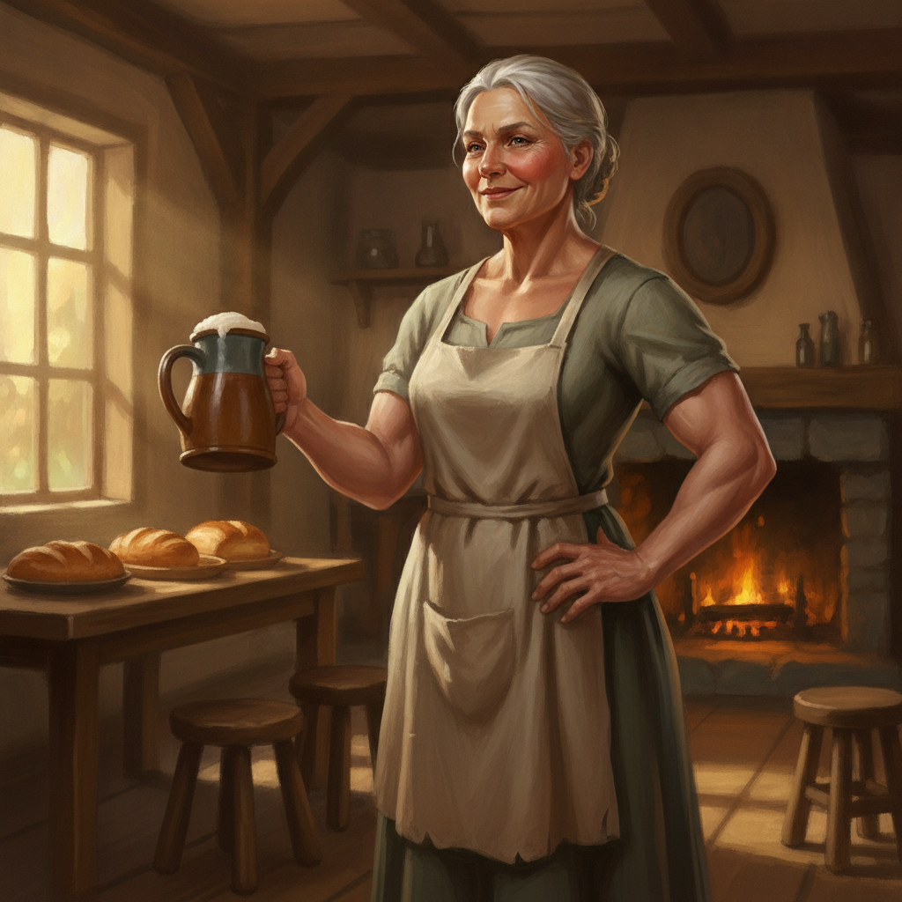

# Wirtin Alma

**Gasthaus „Zur Sichel“, Sommerhall.** Mütterlich und resolut, Herz aus Gold, Arme wie ein Schmied; nennt alle „Kind“, auch den Barbaren. Führt das Gasthaus „Zur Sichel“, in dem die Helden als Ehrengäste schlafen und nach dem Traum wieder aufwachen. Ist Tamos Tante und weiß, dass der graue Pilger in Zimmer 4 nie isst. Stirbt Baldric, übernimmt sie seine Rolle als Anführerin der Geflüchteten vor der Kuppel.

→ `Stadt/Sommerhall/Orte/Gasthaus-Zur-Sichel.md`, `Story/Erzaehler/02b-Evakuierung.md`
