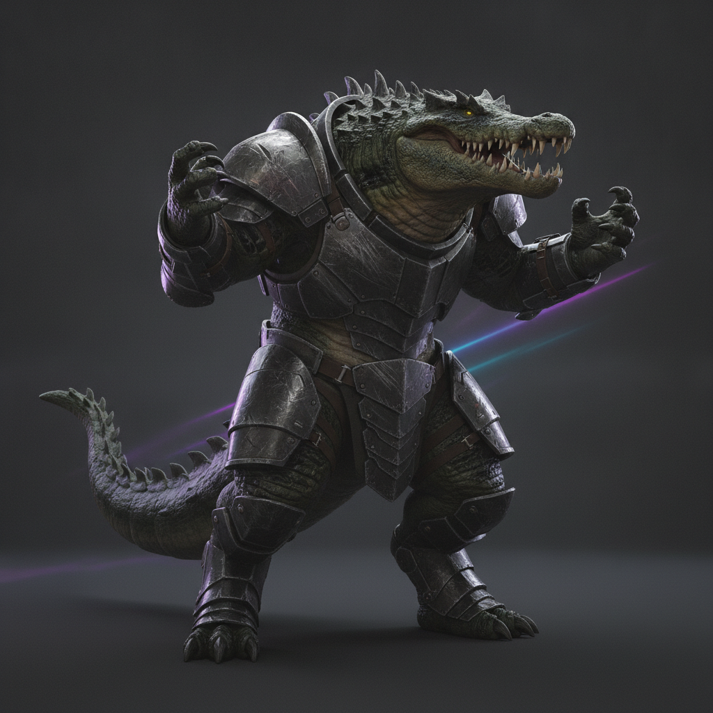

# Gnash Dreizahn – Statistiken

Der **Panzer auf zwei Beinen** der Arena „Magnetron" (→ `../../Uebersicht.md`).
Ein aufrecht gehendes krokodilähnliches Monster von einer Sumpfwelt,
zwei Meter hoch und fast ebenso breit, dunkelgrüne Schuppen mit
schwarzem Muster, Hornplatten auf Rücken und Schwanz, eine breite
Schnauze voller Zähne, von denen drei vorne golden überkront sind
(daher der Name). Trägt eine schwere, zerkratzte Plattenrüstung aus
dunklem Metall. Keine Waffe. Gnash braucht keine. Spricht wenig,
grinst viel, und das Grinsen ist das Problem.

| | |
|---|---|
| Typ | Monstrosität (Krokodilvolk), Groß |
| RK | 17 (Plattenrüstung über Schuppenpanzer) |
| TP | 85 |
| Bewegung | 9 m, Schwimmen 12 m |
| STR 20 (+5) | GES 10 (+0) |
| KON 18 (+4) | INT 8 (−1) |
| WEI 12 (+1) | CHA 9 (−1) |
| Fertigkeiten | Athletik +8, Wahrnehmung +4 |
| Rettungswürfe | STR +8, KON +7 |
| Resistenzen | Hieb, Stich (Panzer) |
| Sinne | Dunkelsicht 18 m |
| HG | 4 (1.100 XP) |

**Panzerhaut:** Jeder Treffer, der Gnash weniger als 8 Schaden
zufügt, prallt am Panzer ab (0 Schaden, das Publikum stöhnt). Alles
ab 8 Schaden geht normal durch.

**Schwäche: Die Lücke am Bauch.** Die Rüstung endet über dem weichen,
hellen Bauch. Wer Gnash **liegend** oder **gepackt** vorfindet oder
ihm mit einer Finte (Täuschung DC 14) den Blick nach oben zwingt,
trifft die Lücke: Der Angriff ignoriert die Panzerhaut und die
Resistenzen. Kaltblüter: Kälteschaden halbiert Gnashs Bewegung bis zum
Ende seines nächsten Zuges, und er kann keine Todesrolle ausführen.

**Preisgeld:** 250 Credits. **Quote:** 2:1.

Fähigkeiten → `../Faehigkeiten/Faehigkeiten.md`
