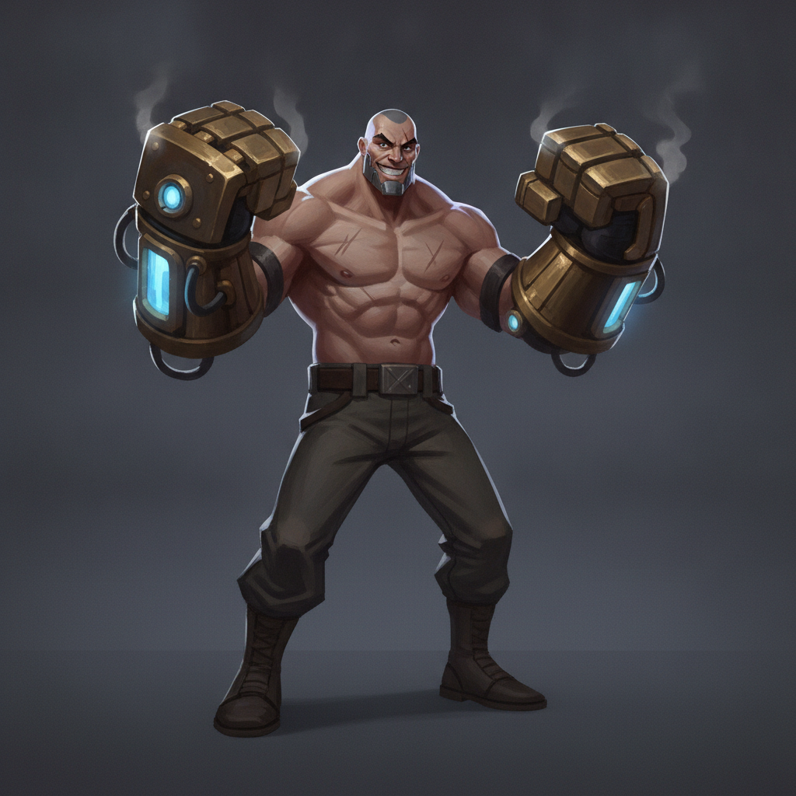

# Mack „Der Hammer" Dorrigan – Statistiken

Der **Brawler** der Arena „Magnetron" (→ `../../Uebersicht.md`). Ein
Mensch, oder war es mal: 2,10 m, Boxer von einer Minenwelt, beide
Arme bis zur Schulter durch dampfbetriebene Messing-Hydraulikfäuste
mit blau glimmenden Energiekammern ersetzt, dazu eine Stahlplatte
im Kiefer, die er beim Grinsen zeigt. Mack ist laut, herzlich, dumm
wie ein Amboss und der beliebteste Kämpfer im Haus. Er umarmt jeden
Gegner, vorher und nachher.

| | |
|---|---|
| Typ | Humanoid (Cyborg), Mittelgroß |
| RK | 15 (Panzerplatten, kein Ausweichen) |
| TP | 75 |
| Bewegung | 9 m |
| STR 20 (+5) | GES 12 (+1) |
| KON 18 (+4) | INT 7 (−2) |
| WEI 8 (−1) | CHA 13 (+1) |
| Fertigkeiten | Athletik +8, Einschüchtern +4 |
| Rettungswürfe | KON +7 |
| Resistenzen | Wucht (er hat schon alles abbekommen) |
| HG | 4 (1.100 XP) |

**Nehmerqualitäten:** Fällt Mack zum ersten Mal in einem Kampf auf
0 TP, steht er mit 10 TP wieder auf (1× pro Kampf). Das Publikum
tobt. Beim zweiten Mal bleibt er liegen.

**Schwäche: Weisheit 8.** Mack fällt auf **Finten** herein: Eine
Täuschung DC 13 (als Bonusaktion) gibt dem Helden Vorteil auf den
nächsten Angriff gegen ihn. Funktioniert jede Runde. Mack merkt es
nicht einmal beim fünften Mal.

**Preisgeld:** 300 Credits. **Quote:** 3:1.

Fähigkeiten → `../Faehigkeiten/Faehigkeiten.md`
