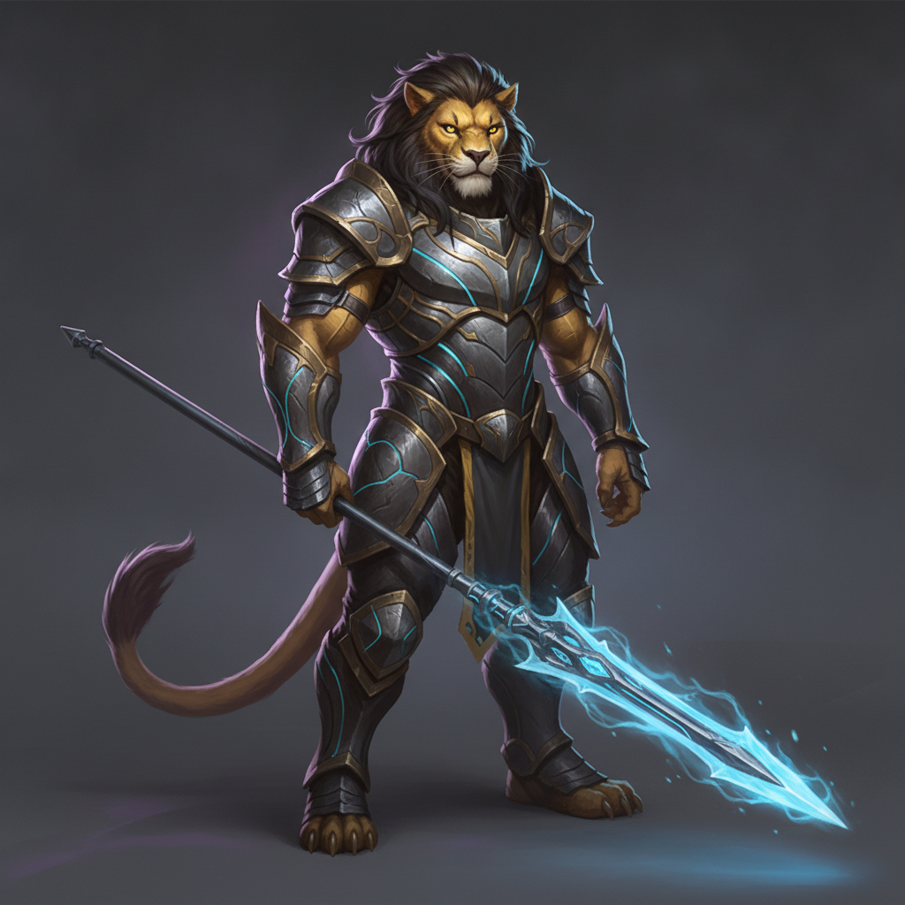

# Serrak Goldmähne – Statistiken

Der **Duellant** der Arena „Magnetron" (→ `../../Uebersicht.md`). Ein
Katzenkrieger, 1,90 m, goldenes kurzes Fell, eine dunkle, wilde Mähne,
bernsteinfarbene Augen und Raubtierzähne. Trägt eine elegante
Vollrüstung aus dunklem Metall mit goldenen Kanten und schmalen blau
leuchtenden Linien, den Helm hat er abgelegt („Das Publikum soll das
Gesicht sehen, das es schlägt"). Seine Waffe: ein langer Speer mit
einer Klinge aus blauem Energielicht. Serrak ist stolz, höflich,
schnell und so eitel, dass es zur Waffe gegen ihn wird. Er kämpft seit
sechs Jahren hier, ungeschlagen gegen alles, was langsamer ist als er.

| | |
|---|---|
| Typ | Humanoid (Katzenvolk), Mittelgroß |
| RK | 17 (Vollrüstung, Reflexe) |
| TP | 60 |
| Bewegung | 12 m, Klettern 9 m |
| STR 16 (+3) | GES 20 (+5) |
| KON 13 (+1) | INT 12 (+1) |
| WEI 14 (+2) | CHA 16 (+3) |
| Fertigkeiten | Akrobatik +9, Wahrnehmung +6, Auftreten +7 |
| Rettungswürfe | GES +9 |
| Sinne | Dunkelsicht 18 m |
| HG | 4 (1.100 XP) |

**Katzenreflexe:** Serrak kann sich aus der Reichweite eines Gegners
bewegen, ohne einen Gelegenheitsangriff auszulösen, und nimmt keinen
Fallschaden unter 6 m. Er landet immer auf den Füßen (kann nicht
liegend gemacht werden, solange er bei Bewusstsein ist).

**Reichweite:** Der Energiespeer hat 3 m Reichweite. Serrak hält den
Helden auf Abstand und tanzt um ihn herum.

**Schwäche: Stolz.** Serrak lässt sich **provozieren**. Wer ihn
beleidigt oder verspottet (Aktion, Täuschung oder Auftreten DC 13),
bringt ihn aus dem Konzept: Er greift den Spötter bis zum Ende seines
nächsten Zuges mit **Nachteil** an und verliert die Parade. Wer ihn
dagegen **lobt**, bekommt eine Verbeugung und eine Runde, in der
Serrak nicht angreift (einmal pro Kampf, danach merkt er es).

**Preisgeld:** 250 Credits. **Quote:** 2:1.

Fähigkeiten → `../Faehigkeiten/Faehigkeiten.md`
