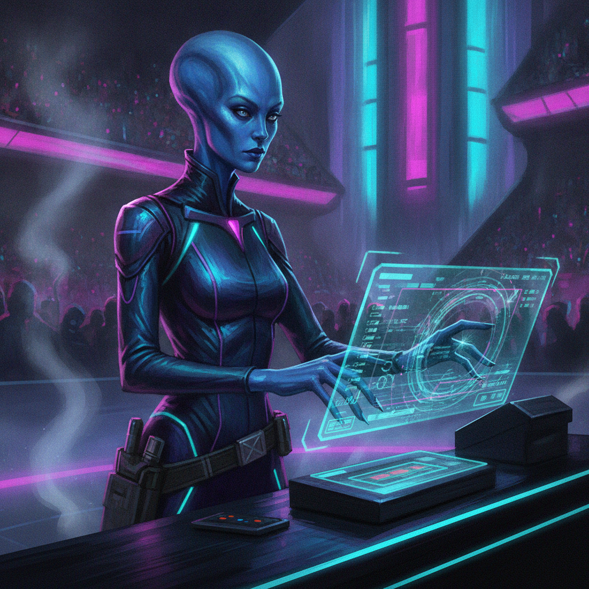

# Lix Tarenko – Der Wettschalter

Die Buchmacherin der Arena „Magnetron" (→ `../../Beschreibung.md`).
Ohne Lix wäre die Arena nur ein Kampf. Mit ihr ist sie ein Abend.

## Erscheinung & Wesen

Schlank, blaue Haut, sechs Finger an jeder Hand, die unablässig in
ein Hologramm vor ihr tippen, in dem Quoten auf- und abschwirren wie
Mücken. Spricht schnell, lächelt selten, verrechnet sich nie. Sie
mag Leute, die wetten, und misstraut Leuten, die gewinnen.

## Wetten (so läuft es)

- **Einsatz:** mindestens 10 Credits, höchstens 500 pro Wette.
- **Quote** steht an jedem Kämpfer (→ `../../Kaempfer/Uebersicht.md`).
  „3:1" heißt: 10 Credits Einsatz bringen bei Sieg 30 Credits
  Gewinn plus den Einsatz zurück.
- **Wetten auf einen Helden:** Lix nimmt die Quote des Kämpfers, gegen
  den er antritt. Wer auf den eigenen Freund wettet, wettet gegen die
  Quote des Gegners. Wer **gegen** den eigenen Freund wettet, bekommt
  Quote 1:2 (und ein Gespräch am Tisch).
- **Schaukämpfe:** Vor dem ersten Heldenkampf kämpfen zwei Arena-Kämpfer
  gegeneinander. Lix nennt den Favoriten. Die Spieler würfeln den
  Ausgang mit einem W6: 1–3 der Favorit gewinnt (Quote 1:1), 4–6 der
  Außenseiter (Quote 3:1).
- **Wetten auf Einzelheiten** (Lix' Spezialität, Quote 4:1): „Kampf
  endet in Runde 3", „Erster Treffer geht an den Roboter", „Jemand
  landet im Publikum". Nur für Spieler, die es genau wissen
  wollen.

**Die eine Regel:** Wer auf sich selbst wettet und absichtlich
verliert, hat **Arenaverbot**. Lix erkennt das sofort („Sechs
Finger, zwei Augen, null Geduld für Betrug."), und Vexx steht hinter
ihr.

**Typische Sätze:**
- „Einsatz. Quote. Gewinn. Fragen? Nein. Nächster."
- „Du wettest gegen deinen Freund? Mutig. Ehrlich. Eins zu zwei."
- „Ich habe mich noch nie verrechnet. Du bist nicht die Ausnahme."

**Werte:** RK 13, 30 TP, unbewaffnet. Sie braucht keine Waffe. Sie hat
Vexx.
