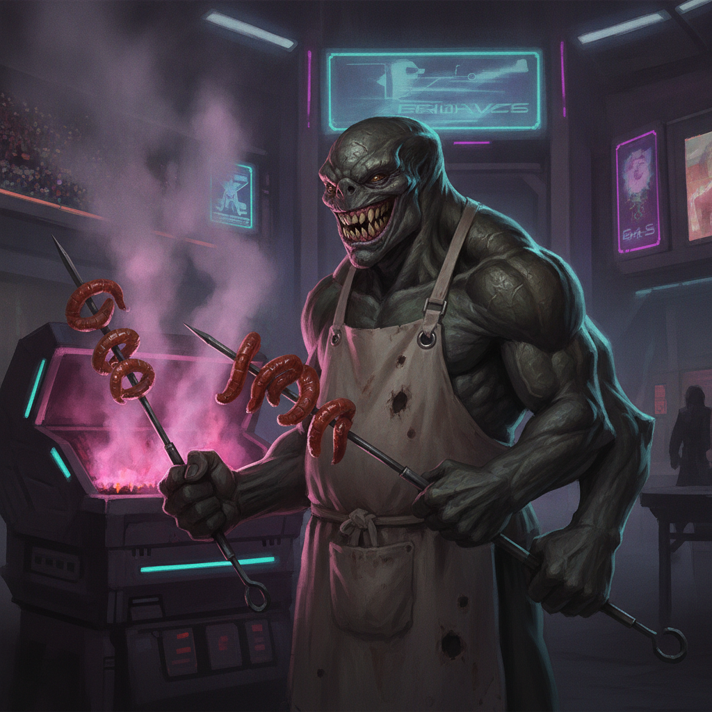

# Grillmeister Bolo – Bolos Grill

Der Essensverkäufer im Vorraum der Arena „Magnetron"
(→ `../../Beschreibung.md`), direkt neben dem Eingang. Der Rauch
seines Grills hängt über dem ganzen Stadion.

## Erscheinung & Wesen

Zwei Meter breit, vier Arme, in jedem ein Spieß, eine Schürze mit
Brandlöchern und ein Lächeln mit zu vielen Zähnen. Bolo redet laut,
kocht lauter und hält jeden, der sein Essen lobt, für einen Freund
fürs Leben. Er kennt jeden Kämpfer der Arena seit Jahren und erzählt
ungefragt, wie man sie schlägt (→ „Bolos Tipps" unten).

## Speisekarte

| Gericht | Preis | Effekt |
|---|---|---|
| **Rauchwürmer am Spieß** (dick wie ein Daumen, knusprig, schmecken nach Speck) | 10 Cr | 1W6 temporäre TP bis zur nächsten Rast |
| **Blaues Brausezeug** (leuchtet, kalt, prickelt) | 5 Cr | Man rülpst 1 Stunde lang kleine blaue Funken. Sonst nichts. |
| **Lavabrot** (rote Kruste, innen flüssig) | 8 Cr | Vorteil auf den nächsten KON-Rettungswurf |
| **Proteinriegel, Geschmack Ente** | 3 Cr | Eine Ration. Schmeckt nicht nach Ente. |
| **Bolos Spezial** (fragt nicht, was drin ist) | 15 Cr | Heilt 1W8 TP. KON DC 10, sonst 1 Minute Schluckauf mit Nachteil auf Heimlichkeit |

## Bolos Tipps (gratis, wenn man dreimal bei ihm isst oder ihn ernsthaft lobt)

- „BOLZEN? Blitz. Irgendwas mit Blitz. Dann steht er da wie ein Kühlschrank."
- „Gnash? Kleine Schläge prallen ab. Hau EINMAL richtig. Oder wirf ihn um, der Bauch ist weich. Sag ihm nicht, dass ich das gesagt habe."
- „Mack? Mack ist mein Freund. Mack ist dumm. Täusch ihn an, er beißt an. Sag ihm nicht, dass ich das gesagt habe."
- „Die Katze? Lob sie nicht. Oder doch, einmal. Und dann beleidige sie. Dann vergisst sie den Speer."
- „GOLIATH? Hinten. Drei Kerne. Keiner kommt hinten dran. Du vielleicht."

**Bolos Freundschaft:** Wer dreimal isst, bekommt beim Abschied einen
Beutel mit zehn Proteinriegeln. Geschmack Ente. „Für die Reise. Ihr
seht hungrig aus."
