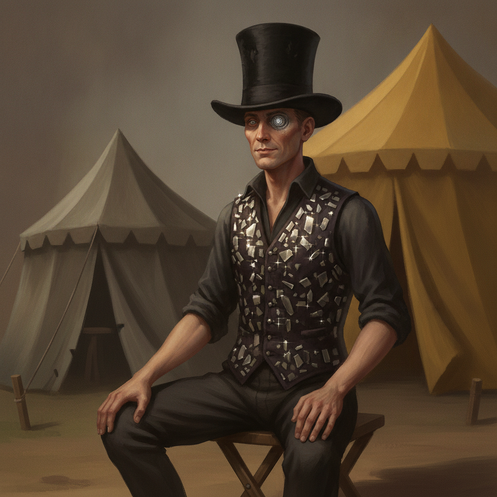

# Valerian Quecks

Der Mann vor dem grauen Zelt beim Zirkus. Zugang zum Spezial-Event
„Die Arena von Rubian 5" (→ `../../Beschreibung.md`).

## Erscheinung & Wesen

Hager, Mitte fünfzig oder dreihundert, schwer zu sagen. Schwarzer
Zylinder, eine Weste, in die Dutzende Spiegelsplitter eingenäht sind,
das linke Auge silbern wie Quecksilber und ohne Pupille. Spricht
leise, langsam und nie einen Satz zu viel. Riecht nach kaltem Metall.

Quecks ist ein **Wanderer zwischen Welten**. Er weiß genau, wo er ist,
und warum: Er ist **immer dort, wo es schlimm wird**, und das seit
sehr langer Zeit. Er ist **gut, aber auf keiner Seite.** Er warnt
nicht, greift nicht ein, hilft nicht gegen den Dämon und gehört nicht
zum Kult. Er sieht zu, und er bietet denen, die von sich aus fragen,
eine Tür woandershin. Mehr nicht. Flimm nimmt ihn seit zwölf Jahren
mit, weil er pünktlich zahlt und weil der Zirkus seit damals in keinem
Unwetter mehr stand.

**Was er nie tut:** Gold nehmen, auf Drohungen reagieren (das Zelt ist
dann leer, und er sitzt zwei Stände weiter), Fragen zu seiner
Herkunft beantworten („Weit weg. Oder nah. Kommt auf den Spiegel an."),
Partei ergreifen.

**Funktion in der Story:**
- Kapitel 1: Tierschau, Überreden, Spiegel. Wer ihn nach dem Grund
  seiner Anwesenheit fragt: „Ich bin immer da, wo etwas passiert.
  Fragt nicht, was. Ihr seht es früh genug." Ein Vorbote, den die
  Spieler erst nach Kapitel 2 verstehen.
- Kapitel 3 (zweiter Durchlauf): „Ihr wisst es jetzt, oder? Man sieht
  es euch an." Sonst nichts.
- Kapitel 7 (optional): Sein Zelt steht am Rand des Flüchtlingslagers.
  Er sagt nichts. Der Spiegel funktioniert.

**Typische Sätze:**
- „Ausgebucht."
- „Besonders. Hm. Wie besonders?"
- „Wer durchgeht, kommt auch wieder. Immer. Das verspreche ich."
- „Sagt niemandem, was ihr gesehen habt. Glaubt euch sowieso keiner."

Werte → `Stats/Stats.md` · Fähigkeiten → `Faehigkeiten/Faehigkeiten.md`
