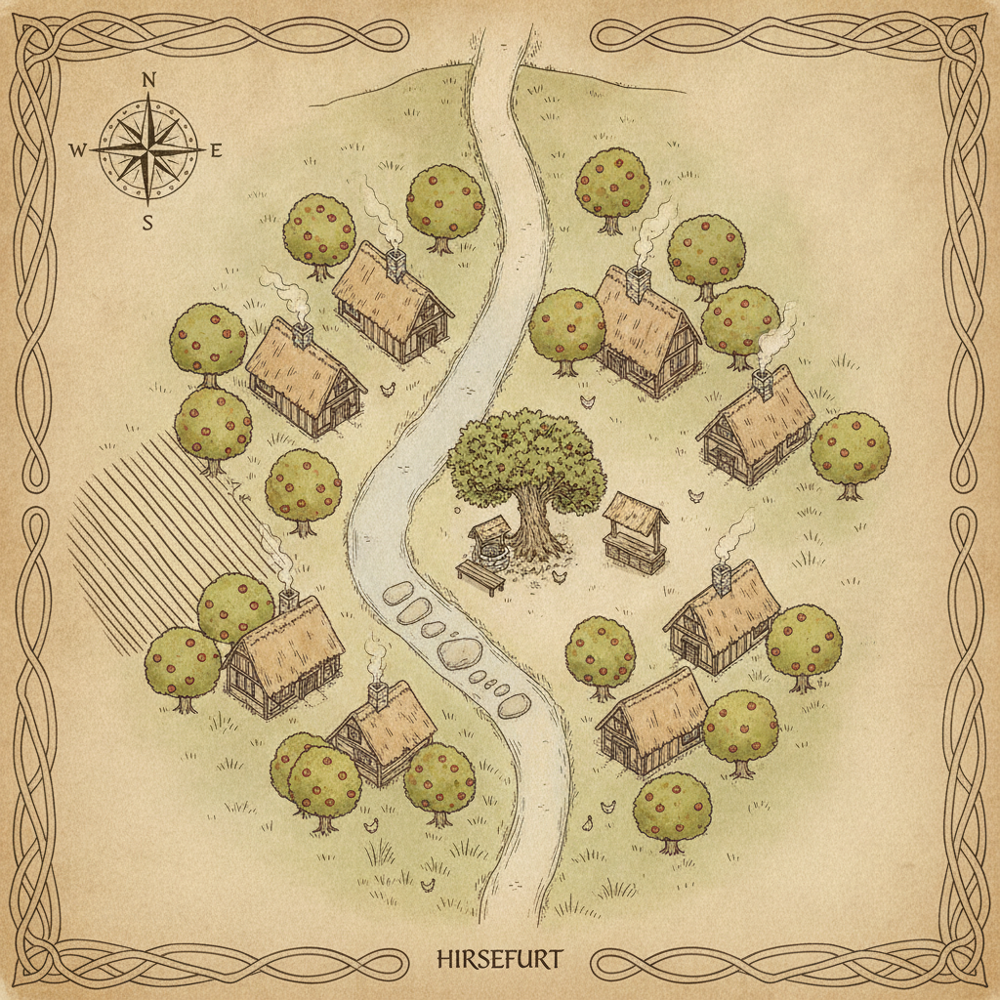
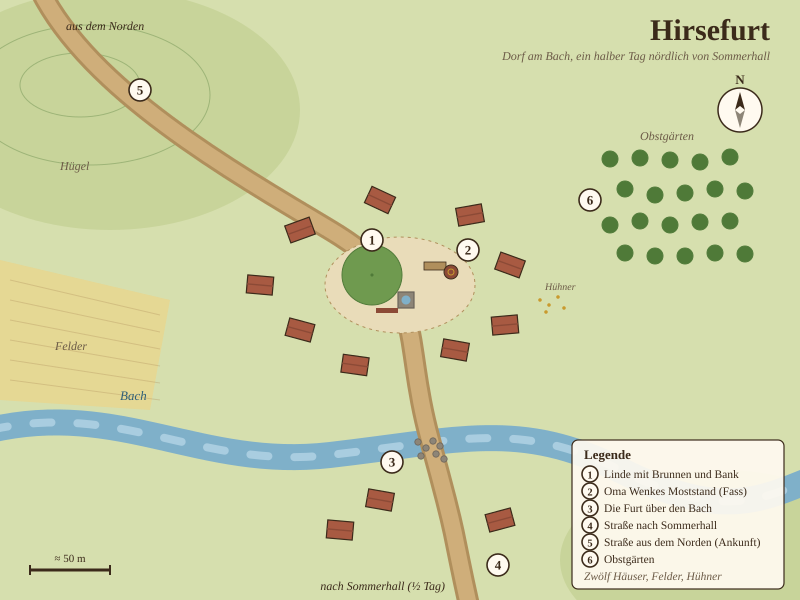

# Vorspiel: Rast in Hirsefurt

**Nur für den Erzähler.** Der Einstieg in die Kampagne, noch vor dem
Fest (→ danach Kapitel 0.5, der Weg nach Sommerhall, dann Kapitel 1).

## Ausgangslage

**Vorgeschichte:** Vor einem Monat stand die Gruppe in der **Schlacht
am Rabenpass**, hoch im Norden: Drei Tage lang hielten die Freien
Städte des Nordens den Pass gegen die Eishorde der **Grauen Khane**,
und am Ende hielten sie ihn. Die Helden waren mittendrin. Was genau
sie dort getan haben, dürfen die Spieler selbst erzählen (wer hat
wen gerettet, wer hat welche Narbe daher); du musst nur wissen: Es
war groß, es war blutig, und danach wollten sie **weit weg**.

Ihr Plan: Nach Süden, über das Meer, auf den Kontinent **Seranth**,
von dem die Händler erzählen (Gewürzstädte, Sonne, Ruinen, die noch
niemand ausgegraben hat). Sie sind also **auf der Durchreise**. Seit
einem Monat ziehen sie gemütlich von Dorf zu Dorf und von Stadt zu
Stadt, ohne Eile, schlafen in echten Betten, essen sich satt und
genießen die schönen Länder, durch die sie kommen. Die Küste mit den
Häfen nach Seranth liegt noch gut zwei Wochen südlich.

Dieser Monat war ihre Pause. Sie sind **vollständig erholt**: volle
HP, alle Zauberslots, Zustände geheilt, plus **1 Inspiration** pro
Spieler als „Erholungsbonus". Vom Fest in **Sommerhall** haben sie
noch nichts gehört; davon erfahren sie erst hier, in einem kleinen
Dorf am Wegrand (Handout: `Story/Spieler/Handout-Fest-Einladung.md`).

**Ziel der Szene:** Die Spieler sollen das Gefühl haben, **selbst
entschieden** zu haben, zum Fest zu gehen. Keine Einladung, kein
Auftrag, nur ein Flyer und ein paar gute Gründe. Richtwert: 10–15
Minuten.

**Ort:** **Hirsefurt**, ein Dorf mit zwölf Häusern, einer Furt über
den Bach und einem Brunnen unter einer alten Linde. Ein halber Tag
Fußweg (zu Pferd: ein paar Stunden) nördlich von Sommerhall. Es ist
der **Tag vor dem Fest**, früher Nachmittag.

## Karte: Hirsefurt von oben

**Bildkarte zum Herzeigen am Tisch** (KI-erzeugt im D&D-Stil, Pergament):

Datei: `Story/Erzaehler/Karten/Karte-Hirsefurt-KI.png`. Der Bach läuft von
Norden nach Süden durchs Dorf, die Furt liegt südlich der Linde, Felder im
Westen, Obstbäume rundherum. Die Bildkarte hat absichtlich keine Nummern;
die Nummern der Legende beziehen sich auf den Lageplan darunter.

**Lageplan für dich** (gezeichnet, mit Nummern zur Legende):

Datei: `Story/Erzaehler/Karten/Karte-Hirsefurt.svg` (als PNG:
`Karte-Hirsefurt.png` im selben Ordner).

**Legende:**
1. **Linde mit Brunnen und Bank**: der Dorfplatz, hier rasten die Helden.
2. **Oma Wenkes Moststand**: ein Fass und ein Brett daneben, zwei Kupfer der Becher.
3. **Die Furt**: flache Steine im Bach, man kommt trockenen Fußes rüber.
4. **Straße nach Sommerhall**: über die Furt nach Süden, ein halber Tag zu Fuß.
5. **Straße aus dem Norden**: hier kommen die Helden über den Hügel ins Dorf. Tamos Esel klappert dieselbe Straße entlang.
6. **Obstgärten**: Apfelbäume, daher der Most.

Dazu zwölf Häuser (neun diesseits, drei jenseits des Bachs), Felder im
Westen und Hühner, die überall herumlaufen. Mehr gibt es in Hirsefurt
nicht, und genau das ist der Punkt.

## Die Szene

**Vorlesetext – Ankunft:**

> Ein Monat ist es her, seit der Rabenpass hinter euch lag, und mit
> jedem Tag nach Süden wurde das Land weicher: Wiesen statt Geröll,
> Obstbäume statt Schnee, Dörfer, in denen niemand eure Namen kennt
> und niemand etwas von euch will. Genau so wolltet ihr es. Die
> Straße wird staubig, die Sonne steht hoch, und eure Beine
> erinnern sich daran, dass ein Monat Ruhe die Muskeln weich macht.
> Hinter einem Hügel taucht ein Dorf auf: ein Dutzend Häuser, eine
> Linde, ein Brunnen, und eine Bank davor, die aussieht, als hätte
> sie genau auf euch gewartet. Eine alte Frau verkauft Apfelmost aus
> einem Fass, zwei Kupfer der Becher. Irgendwo gackern Hühner. Sonst
> passiert hier gar nichts.

Lass die Spieler ankommen: Most kaufen, Pferde tränken, sich
unterhalten. Die Mostfrau heißt **Oma Wenke** und erzählt gern, dass
„die ganze Jugend nach Sommerhall gelaufen ist, wegen dem Fest".

Ganz leer ist das Dorf aber nicht. Wenkes Kinder sind längst erwachsen
und stehen draußen auf den Feldern im Westen: Ihr Sohn **Jorin** (Ende
dreißig, breite Schultern, redet wenig) und ihre Tochter **Liese**
(ein paar Jahre jünger, hat das Mundwerk der Mutter geerbt) bringen
mit zwei Knechten die Gerste ein. „Irgendwer muss ja hierbleiben und
nach den Feldern schauen", sagt Wenke, „das Korn wartet auf kein
Fest." Sie selbst bleibt auch: „Wenn die beiden abends reinkommen, steht
das Essen auf dem Tisch. Das war immer so, und so bleibt das." Wer über
die Felder schaut, sieht in der Ferne Jorins Strohhut zwischen den
Garben auftauchen und wieder verschwinden; Liese winkt, wenn man winkt.
Von der Linde zu den Feldern sind es nur ein paar hundert Schritt. Gehen
die Helden hin, wischt sich Jorin die Hände an der Hose ab, gibt jedem
einen festen Händedruck und hat genau drei Sätze übrig; Liese redet
dafür für zwei und bestätigt, was die Mutter sagt: Sie gehen nicht zum
Fest, „sonst frisst das Wetter die halbe Ernte, und Mutter bringt uns um".

**Vorlesetext – der Flyer-Junge:**

> Da klappert es auf der Straße. Ein Esel trabt ins Dorf, schwer
> beladen mit zwei Satteltaschen, und obendrauf sitzt ein Junge, vielleicht
> zwölf, mit Sommersprossen und einer viel zu großen Mütze. Er springt
> ab, bevor der Esel steht, reißt eine Tasche auf und wedelt mit einem
> Stapel bunter Zettel. „Fest der Goldenen Ähre! Morgen in
> Sommerhall! Freibier, Festspiele, Preise in Gold!" Dann sieht er
> eure Waffen, eure Rüstungen, eure Narben – und bleibt wie
> angewurzelt stehen. „Seid… seid ihr etwa Abenteurer? Echte?"

Der Junge ist **Tamo**, Neffe von Festmeister Baldric
(→ `NPC/Festmeister-Baldric/`). Er verteilt seit drei Tagen Flyer in
allen Dörfern rund um Sommerhall und ist stolz darauf. Er drückt jedem
Helden einen Flyer in die Hand (→ **Handout**). Bevor er weiterzieht
(er hat noch zwei Dörfer vor sich, Eschenbrück und Kohlwinkel, und ist
deshalb **nicht** vor den Helden in der Stadt), kritzelt er jedem auf
die Rückseite eine Notiz für seine Tante: *„Tante Alma, das sind echte
Helden vom Rabenpass. Bett in der Sichel! Tamo."* Das sichert ein Bett,
mehr nicht; den Ehrenplatz verdienen sie sich unterwegs (→ Kapitel 0.5).

**Was Tamo erzählt (je nachdem, was die Spieler fragen):**
- „Mein Onkel ist der Festmeister! Wenn ihr kommt, sag ich ihm, dass
  ich echte Helden gefunden hab, sobald ich zurück bin. Dann kriegt ihr bestimmt umsonst
  Bier."
- Fragt er, woher sie kommen, und hört „Rabenpass": große Augen.
  „Vom Rabenpass? Von der Schlacht? Mein Onkel hat davon erzählt!
  Dann MÜSST ihr kommen, Fremde, die Abenteuer erlebt haben, sollen
  sie am Feuer erzählen, steht sogar auf dem Zettel!"
- „Bei den Festspielen gibt's richtige Preise. Letztes Jahr hat einer
  einen Dolch gewonnen, der im Dunkeln leuchtet!"
- „Im Gasthaus ‚Zur Sichel' gibt's die weichsten Betten der Welt.
  Sagt meine Tante. Die ist die Wirtin." (Gemeint ist Alma,
  → `Stadt/Sommerhall/Orte/Gasthaus-Zur-Sichel.md`.)
- Leiser, wenn man ihn fragt, ob alles in Ordnung ist: „Na ja… in
  letzter Zeit gibt's kleine Überfälle. Auf der Straße, im Wald
  hinter den Mühlen. Die nehmen einem die Börse ab und rennen weg.
  Aber bestimmt nicht morgen, da ist ja überall Wache."
  (Aufhänger für Kapitel 1, Szenario E: Die Helden können das Fest
  sausen lassen und die Räuber suchen.)

**Gute Gründe, die du beiläufig einstreuen kannst (nicht alle auf
einmal):**
- Die Festspiele versprechen Preise (→ `Story/Spieler/Festspiele.md`,
  `Belohnungen/Uebersicht.md`, „Festpreise").
- Sie haben es nicht eilig. Seranth läuft nicht weg, und genau solche
  Feste sind der Grund, warum sie langsam reisen.
- Oma Wenke: „Das Dunkelbier in Sommerhall, Kinder. Dafür lohnt sich
  der Umweg, und es ist nicht mal einer."
- Liese, vom Feld herüber: „Geht nur. Einer von uns muss schließlich
  wissen, wie das Freibier war, und Jorin erzählt ja nichts."

**Übergang:** Brechen die Helden auf, frag beiläufig, wohin: direkt
nach Sommerhall oder erst zu den Räubern. Beides führt in
**Kapitel 0.5** (→ `00b-Der-Weg-nach-Sommerhall.md`): Auf der Straße
wird die Kutsche der Brauerin Gesa überfallen, die Helden retten Bier,
Leute und ein kleines Mädchen mit Holzpferd, geben die Räuber am
Wachposten ab und werden dafür zu **Ehrengästen**. Sie übernachten im
Gasthaus „Zur Sichel" und wachen am **Morgen des Fests** dort auf
(→ Kapitel 1).

---

## Szenarien – was die Spieler tun könnten

> **So sind die Szenarien sortiert:** ⭐ **Optimal** = so ist dieses
> Kapitel gedacht · ➖ **Leichte Abweichung** = gleiche Richtung,
> anderer Weg · 🔀 **Ganz anders** = die Gruppe verlässt den geplanten Weg.

**⭐ Der optimale Weg**

### Szenario A · ⭐ Optimal: Sie nehmen den Flyer und gehen zum Fest

Genau so ist es gedacht. Weiter mit dem Übergang oben und Kapitel 1.

**➖ Leichte Abweichungen**

### Szenario B · ➖ Leichte Abweichung: Die Überfälle lassen sie nicht los

Die Helden fragen Tamo und Oma Wenke über die Räuber aus. Oma Wenke
weiß: „Drüben im Wald hinter den Mühlen, sagt man. Haben dem
Krämer die Kiste mit den Nägeln geklaut. Nägel! Wer klaut denn
Nägel?" Jorin auf dem Feld hat mehr gesehen, wenn man ihn fragt:
„Vorgestern. Vier Gestalten am Waldrand, bei Dämmerung. Sind nicht
stehen geblieben." Mehr sagt er nicht, aber es stimmt. Wollen sie
sofort los, greift die Weiche aus Kapitel 0.5: Wer zuerst zu den
Räubern will, erlebt keinen Überfall, sondern findet das Lager einen
Tag früher (→ `00b-Der-Weg-nach-Sommerhall.md`, Szenario D). Wollen
sie erst in die Stadt, kommt der Überfall auf der Straße (Szenario A
dort), und das Lager bleibt für den Festtag (→ Kapitel 1, Szenario E).

**🔀 Ganz andere Verläufe**

### Szenario C · 🔀 Ganz anders: Die Gruppe will gar nicht zum Fest

Die Spieler haben die Wahl, also dürfen sie auch Nein sagen. Zwing
sie nicht, sondern lass die Welt ziehen:
- **Das Wetter:** Gegen Abend zieht ein Gewitter auf, kalt und
  stundenlang. Das nächste Dach mit freien Betten ist Sommerhall (in
  Hirsefurt ist alles voll mit Verwandtschaft, die morgen zum Fest
  will).
- **Tamo:** Sein Esel lahmt auf halbem Weg, der Junge sitzt allein
  am Straßenrand mit zwei Taschen Flyer. Wer ihn nach Hause bringt,
  steht vor Baldric, und der lässt keine Helden einfach wieder gehen.
- **Der Weg:** Sommerhall liegt ohnehin an ihrer Route nach Süden;
  wer die Stadt umgehen will, braucht einen Tag länger durch die
  Mühlenwälder, in denen die Räuber sitzen.

Bleiben sie trotz allem stur, verlege den Start: Sie hören am
Festabend aus der Ferne die Musik, dann einen Schrei, der nicht
aufhört, und sehen violettes Licht über den Dächern. Spiele Kapitel 2
so, als kämen sie von draußen (wie Kapitel 1, Szenario C). Wichtig:
In Kapitel 3 wachen sie trotzdem im Gasthaus „Zur Sichel" auf, am
Morgen des Fests. Das ist dann für alle unheimlich, denn dort haben
sie nie übernachtet.
