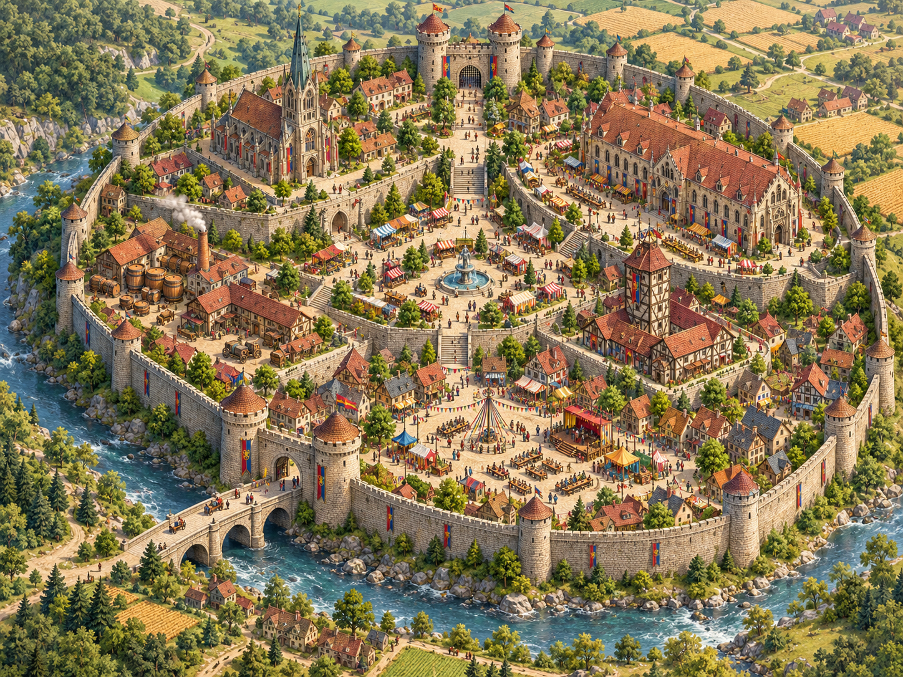
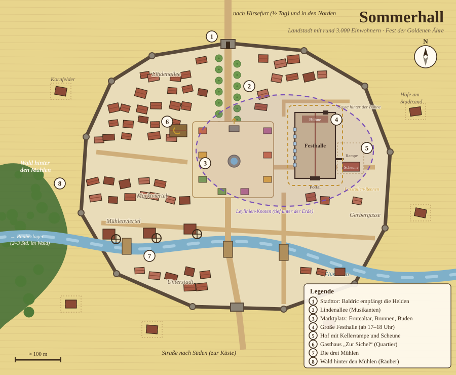

# Kapitel 1: Das Fest der Goldenen Ähre

**Nur für den Erzähler.**

## Ausgangslage

Die Helden sind über das Vorspiel und den Weg nach Sommerhall
hierhergekommen (→ `00-Vorspiel-Hirsefurt.md`,
`00b-Der-Weg-nach-Sommerhall.md`): Tamo hat ihnen in Hirsefurt einen
Flyer gegeben, unterwegs haben sie die Kutsche der **Brauerin Gesa**
vor Räubern gerettet (mit dem Jahrgangsbier für die Halle und Gesas
Tochter **Mira**), die Torwachen haben sie durchgewinkt und hinauf zu
Baldric geschickt, und der hat sie vor der Festhalle zu **Ehrengästen**
gemacht. Sie
wachen am **Morgen des Fests** im Gasthaus „Zur Sichel" auf
(→ `Stadt/Sommerhall/Orte/Gasthaus-Zur-Sichel.md`).
Beschreibe diesen Morgen liebevoll und merke dir deine Worte: Genau
dieser Morgen kehrt in Kapitel 3 zurück.

## Karte: Sommerhall von oben

**Bildkarte zum Herzeigen am Tisch** (KI-erzeugt im D&D-Stil, Pergament):

Datei: `Story/Erzaehler/Karten/Karte-Sommerhall-KI.png`. Die Bildkarte zeigt
die ganze Stadt: das große Haupttor mit zwei Türmen im Norden, die
Lindenallee bis zum Marktplatz mit Brunnen und Buden, östlich davon die
riesige Festhalle mit der Rennstrecke, davor am Markt das Gasthaus „Zur
Sichel“ (das große Fachwerkhaus mit Turm und Innenhof), im Nordwesten der
Tempel mit dem hohen Turm, im Westen die Brauerei mit Kesseln und
Fässern, die große Steinbrücke über den Fluss, vor dem Südtor die
Unterstadt und das Spielfeld für die Festspiele, dahinter der Wald. Die
Bildkarte hat absichtlich keine Nummern; die Nummern der Legende beziehen
sich auf den Lageplan darunter, der die Stadt nur grob vereinfacht zeigt.

**Lageplan für dich** (gezeichnet, mit Nummern zur Legende):

Datei: `Story/Erzaehler/Karten/Karte-Sommerhall.svg` (als PNG:
`Karte-Sommerhall.png` im selben Ordner).

**Legende:**
1. **Stadttor** im Norden, Straße nach Hirsefurt: Die Torwachen kennen Gesa und schicken die Kutsche am Abend vor dem Fest durch zu Baldric vor der Festhalle (→ Kapitel 0.5).
2. **Lindenallee**: die Prachtstraße vom Tor zum Markt, tagsüber spielen hier die Musikanten.
3. **Marktplatz** mit Erntealtar (Norden) und Brunnen der Drei Mühlen (Mitte): tagsüber Buden, Spielstände und Festspiele (→ `Stadt/Sommerhall/Orte/Marktplatz.md`).
4. **Große Festhalle** (ab 17–18 Uhr): Bühne im Norden, großes Portal im Süden, Fensterreihe nach Westen zum Markt, Dienstbotentür hinter der Bühne in die Gasse. Der gestrichelte Ring drumherum ist die Strecke des Fassrollen-Rennens (→ `Stadt/Sommerhall/Orte/Festhalle.md`).
5. **Hof mit Kellerrampe und Scheune**: Hier kommt der Kellerausgang heraus, ein Nebenweg für Eingeweihte (→ Kapitel 2b).
6. **Gasthaus „Zur Sichel"** am Markt, Ecke Lindenallee: Quartier der Helden, Malrik wohnt in Zimmer 4.
7. **Die drei Mühlen** am Flüsschen im Mühlenviertel.
8. **Wald hinter den Mühlen**, westlich vor der Stadt: 2–3 Stunden hinein liegt das Räuberlager (→ Szenario E).

**Violett gestrichelt:** der Leylinien-Knoten, tief unter Festhalle und
halbem Marktplatz. Niemand in Sommerhall weiß davon; er ist nur für dich.

Die sechs Viertel (Lindenallee, Marktviertel, Mühlenviertel, Gerbergasse,
Unterstadt, Höfe am Stadtrand) stehen kursiv auf der Karte; sie zählen
bei der Evakuierung der Stadt (→ `Story/Erzaehler/02b-Evakuierung.md`).

## Stimmung & Ablauf

Das Fest hat zwei Hälften:

**Tagsüber: draußen in der Stadt.** Ganz Sommerhall feiert auf den
Straßen. Auf dem **Marktplatz** stehen Buden und Spielstände
(→ `Stadt/Sommerhall/Orte/Marktplatz.md`), in den Lindenalleen spielen
Musikanten, an jeder Ecke gibt es Braten, Honigkuchen und Festbier.
Hier laufen die **Festspiele** (→ `Story/Spieler/Festspiele.md`):
Axtwerfen, Fassrollen-Rennen um die Festhalle, Rätselzelt, Armdrücken.
**Hauptmann Baldric** (→ `NPC/Hauptmann-Baldric/`) begrüßt die
Helden persönlich und schickt sie zu den Spielen.

**Ab 17–18 Uhr: drinnen in der Großen Festhalle.** Wenn die Sonne
tief steht, läuten die Glocken, und das ganze Fest zieht in die
**Große Festhalle** um (→ `Stadt/Sommerhall/Orte/Festhalle.md`):
Lichterketten, Langtafeln, der Erntealtar, Musikanten auf der Empore,
Tanzfläche. Hier finden Siegerehrung und Festtanz statt, und hier
passiert später das Ritual (→ Kapitel 2).

**Wichtig für dich:** Lass das Fest bewusst **lange gut laufen**. Die
Spieler sollen sich sicher fühlen. Je schöner der Tag, desto härter
der Bruch durch das Ritual (→ Kapitel 2). Richtwert: 45–60 Minuten
echte Spielzeit nur Fest und Spiele.

### Mira, das Mädchen mit dem Holzpferd

Am Abend in der Halle läuft **Mira**, 7, mit ihrem Holzpferd „Hafer"
zwischen den Tischen herum, klaut Honigkuchen und sucht gezielt die
Helden: Sie kennt sie vom Überfall auf die Kutsche (→ Kapitel 0.5).
Ihre Mutter, die **Brauerin Gesa**, steht am Ausschank und schenkt das
Jahrgangsbier aus, deshalb hat Mira den ganzen Abend freie Bahn. Lass
sie den Spielern ans Herz wachsen – sie ist das Kind, das in Kapitel 2
geopfert wird.

**Mira als Überleitung:** Sind die Helden schon eine Weile in der
Halle und entdecken einfach keinen Kultisten, zupft Mira einen Helden
am Ärmel, zeigt in eine Ecke und flüstert:

> „Der Mann in Grau hat gar kein Gesicht."

Dort steht ein Kapuzen-Kultist und murmelt. Das ist die Entdeckung
(→ Kapitel 2, Schritt 2), und die nächste Szene beginnt.

---

## Szenarien – was die Spieler tun könnten

> **So sind die Szenarien sortiert:** ⭐ **Optimal** = so ist dieses
> Kapitel gedacht · ➖ **Leichte Abweichung** = gleiche Richtung,
> anderer Weg · 🔀 **Ganz anders** = die Gruppe verlässt den geplanten Weg.

**⭐ Der optimale Weg**

### Szenario A · ⭐ Optimal: Die Gruppe feiert einfach mit

Sie machen bei den Spielen mit, trinken, gewinnen Preise. Perfekt –
spiele die Festspiele aus, verteile kleine Preise
(→ `Belohnungen/Uebersicht.md`, Abschnitt „Festpreise"). Gehe nach
45–60 Minuten zu Kapitel 2 über.

**➖ Leichte Abweichungen**

### Szenario B · ➖ Leichte Abweichung: Die Gruppe ist misstrauisch und patrouilliert

Abenteurer-Paranoia. Gib ihnen etwas zu finden, aber nicht zu viel:
Bei DC 15 Nachforschung erfahren sie: In den letzten
Wochen sind in Sommerhall **Kerzen, Salz und eine Ziege** gestohlen
worden. Das führt zu Szenario D – aber Malrik lässt sich nicht vor
seiner Zeit erwischen: Falls sie ihm zu früh zu nahe kommen, nutzt er
`Aschengestalt` (→ `Feinde/Ritualist-Malrik/Faehigkeiten/`) und taucht
unter. Das Ritual passiert trotzdem.

### Szenario C · ➖ Leichte Abweichung: Die Gruppe trennt sich / jemand verlässt das Fest

Kein Problem: Das Ritual betrifft die ganze Stadt. Wer draußen ist,
hört die Schreie aus der Festhalle und sieht violettes Licht aus den
Fenstern, und die ersten Gäste stürzen durch das große Portal auf den
Festplatz. Vorgazhul **versiegelt die Nebenausgänge** einen pro Runde
(→ `Stadt/Sommerhall/Orte/Festhalle.md`) – das große Portal lässt er
offen. Wer schnell ist, kommt gegen den Strom noch rein (und raus kommt
man immer).
Hinweis für später: Dass „draußen sein" sich richtig anfühlt, ist ein
leiser Vorgriff auf die Flucht-Lösung (→ Kapitel 4).

**🔀 Ganz andere Verläufe**

### Szenario D · 🔀 Ganz anders: Die Gruppe entdeckt Malrik vor dem Ritual

Belohne das: Sie sehen den grauen Pilger allein vorne an der Bühne
stehen, die Hand im Ärmel, in dem etwas Schwarzes glänzt. Ist es schon
nach dem Höhepunkt des Fests (die Kultisten stehen an ihren Plätzen),
zählt das als **Entdeckung**: Der 5-Minuten-Timer startet sofort
(→ Kapitel 2, Schritt 2 und 3). Davor weicht Malrik aus
(`Aschengestalt`) und taucht unter; der Timer startet dann später wie
gewohnt.

### Szenario E · 🔀 Ganz anders: Sie lassen das Fest sausen und jagen die Räuber

Tamo hat in Hirsefurt von kleinen Überfällen erzählt
(→ `Story/Erzaehler/00-Vorspiel-Hirsefurt.md`), und sechs Räuber
sitzen seit gestern Abend in der Wachstube am Markt (→ Kapitel 0.5). Manche
Gruppen wittern da das echte Abenteuer und ziehen am Festtag los, statt
zu feiern. Lass sie: Die Räuber gibt es wirklich. (Haben sie das Lager
schon in Kapitel 0.5 ausgehoben, Szenario C oder D, entfällt dieses
Szenario.)

**Die Spur:** Wer in Sommerhall herumfragt (Stadtwache, Marktleute,
Alma), hört von Überfällen im **Wald hinter den Mühlen**. Überlebens-
oder Nachforschungsprobe DC 12 findet Trampelpfade, einen verlorenen
Geldbeutel, Lagerfeuerrauch. Nach 2–3 Stunden stehen sie vor dem Lager.

**Das Räuberlager:** Größer als gedacht: eine Lichtung mit Zelten aus
Segeltuch, einem Unterstand voller Diebesgut (Geldbeutel, Würste,
eine Kiste Nägel, ein Fass Festbier) und **etwa 15 Räubern** um ein
Feuer (nur noch **etwa neun**, wenn sechs in Kapitel 0.5 gefangen
wurden). Angeführt von **Hanne „Krähe"**, einer ehemaligen Mühlenarbeiterin.

**Werte der Räuber (schwach!):** RK 12, TP 11, Knüppel oder Kurzschwert
+3 (1W6+1), Kurzbogen +3 (1W6+1). Hanne: RK 13, TP 22, zwei Angriffe.

**Der Kampf:** Greifen die Helden an, wehren sich die Räuber nur kurz.
Sobald die **ersten zwei, drei Räuber tot** am Boden liegen, werfen die
anderen die Waffen weg und ergeben sich („Gnade! Wir haben nie wen
umgebracht!"). Das stimmt: Sie haben **nie jemanden getötet**, nur
Leute überfallen. Es sind arme Leute aus der Umgebung, keine Mörder.
Gib den Spielern ruhig das Gefühl, dass sie hier etwas zu weit
gegangen sind.

**Was die Räuber erzählen (wenn man sie verhört):**
- Sie sind Tagelöhner, die nach der schlechten Ernte im Nachbartal
  nichts mehr hatten.
- Optionaler kleiner Hinweis: Vor einer Woche wollten sie einen
  **grauen Pilger** auf der Straße ausrauben. Er hat sie nur angesehen,
  und in seinem Ärmel glänzte etwas Schwarzes. Seitdem hat Hanne
  Albträume von Spiegeln. (→ Malrik)

**Zurück zum Fest:** Bringen die Helden die Räuber (oder das
Diebesgut) nach Sommerhall, sind sie am Abend die Stars: Baldric lässt
sie bei der Siegerehrung auf die Bühne rufen. Das führt direkt in
Kapitel 2 (Sicherheitsnetz: Auf dem Weg zur Bühne gehen sie an Malrik
vorbei). Bleiben sie zu lange im Wald, erleben sie das Ritual von
draußen: Musik in der Ferne, dann ein Schrei, der nicht aufhört, und
violettes Licht über den Dächern (wie Szenario C).

**Im 2. Durchlauf** (→ Kapitel 3) weiß die Erinnernde, dass die
Räuber harmlos sind. Das Lager ist dann eine verlorene Stunde oder,
wer will, eine Handvoll zusätzlicher Helfer bei der Evakuierung.

---

## Übergang

Am Abend, auf dem Höhepunkt des Fests in der Festhalle, stehen Malrik
und seine 4 Kapuzen-Kultisten an ihren Plätzen im Festsaal und murmeln.
**Kapitel 2 beginnt, sobald ein Held in der Nähe eines Kultisten ist
und ihn entdeckt.** Entdecken sie lange niemanden, hilft Mira nach
(„Der Mann in Grau hat gar kein Gesicht."). Spätestens bei der
Siegerehrung, wenn die Helden auf die Bühne gerufen werden und an
Malrik vorbeigehen, geht es los. → Kapitel 2.
