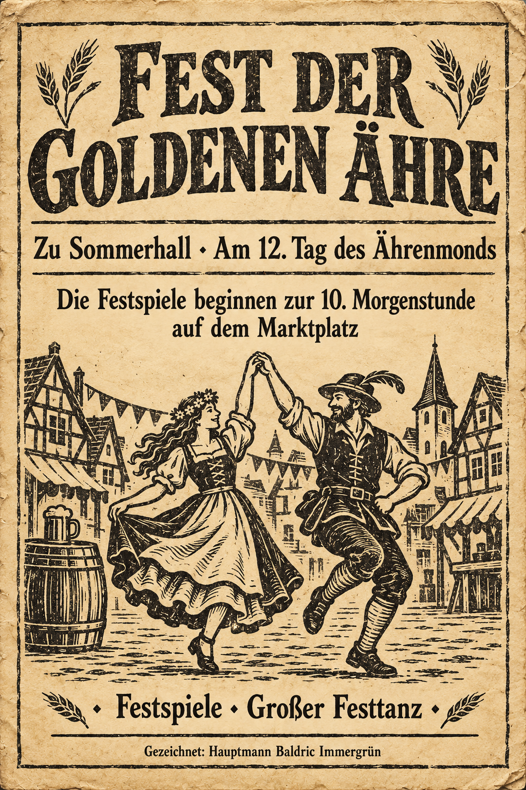

# Handout: Der Fest-Flyer

*Ein grob gedruckter Zettel auf vergilbtem gelbem Papier, an den Ecken
schon etwas zerknittert. Tamo, ein Junge auf einem Esel, verteilt ihn
in Hirsefurt (→ `Story/Erzaehler/00-Vorspiel-Hirsefurt.md`).*

**Zum Herzeigen am Tisch** (ausdrucken oder auf dem Bildschirm zeigen):

Datei: `Story/Spieler/Festflyer-Sommerhall.png`

## Was auf dem Flyer steht

Holzschnitt-Druck mit Ähren in den Ecken, in der Mitte ein tanzendes
Paar vor den Fachwerkhäusern von Sommerhall, daneben ein Bierfass.

> ### FEST DER GOLDENEN ÄHRE
> **Zu Sommerhall · Am 12. Tag des Ährenmonds**
>
> Die Festspiele beginnen zur 10. Morgenstunde auf dem Marktplatz
>
> ✦ Festspiele ✦ Großer Festtanz ✦
>
> Gezeichnet: **Hauptmann Baldric Immergrün**

**Was nicht auf dem Flyer steht, aber jeder in der Gegend weiß** (Tamo
und Oma Wenke erzählen es gern): Freibier beim ersten Krug (das beste
Dunkelbier des Nordens), Preise in Gold und Wunderdingen bei den
Festspielen, Braten, Honigkuchen, Musikanten aus drei Städten, und ab
17 Uhr zieht das ganze Fest in die Große Festhalle um; dort um
Mitternacht der Große Festtanz. Fremde Reisende sind willkommen, und
wer Abenteuer erlebt hat, soll sie am Feuer erzählen.

*Auf der Rückseite, mit Kohle hingekritzelt, in Kinderschrift:*

> Tante Alma, das sind echte Helden vom Rabenpass. Bett in der Sichel!
> Tamo
